# تحليل معمارية الفحص الذكي في الجدار الناري (NGFW)

## 1. التسلسل الكامل: من التقاط الترافيك في النواة إلى وحدة الـ Malware

العملية لا تحدث بانتظار اكتمال تحميل الملفات، بل تحدث عبر تحليل "نهر مستمر" من البايتات (Stream Bytes) في الوقت الفعلي.
في النواة (`F:\enterprise_ngfw\system\inspection_core\framework\pipeline.py`)، يوجد محرك مركزي يُدعى **`InspectionPipeline`**. عندما تدخل حزم البيانات (Packets) بطاقة الشبكة:

1. **الالتقاط والتغليف (Capture & Context):** يقوم الـ Proxy الشفاف بسحب البيانات العابرة من الشبكة وتغليفها في كائن برمجي يسمى `InspectionContext` (يحتوي على عنوان الـ IP، المنفذ، والبروتوكول).
2. **استخبارات ما قبل الفحص (Phase 0 - Threat Intel):** يمررها فوراً لمحرك الاستخبارات السيبرانية `ThreatIntelManager`. إذا كان الـ IP مصنفاً كخبيث أو ضمن شبكات الاختراق (Botnets)، يتم حظره قبل أن يهدر قدرة المعالج.
3. **التوزيع غير المتزامن (Async Dispatch):** عبر حلقة الأحداث (Event Loop)، يقوم الـ Pipeline بتمرير الترافيك فوراً إلى إضافة `NetworkMalwarePlugin` بداخل دالة `inspect_async`. يعمل هذا كمسار موازٍ (Parallel) بحيث تعبر ملايين البيانات دون تأخير ملحوظ في سرعة الشبكة (التأخير يحسب بأجزاء من الملي-ثانية).

### رسم معمارية التسلسل الزمني (Traffic Pipeline Flow)

```mermaid
sequenceDiagram
    participant User as داخل الشبكة (Client)
    participant Core as نواة الجدار (InspectionPipeline)
    participant Malware as وحدة مكافحة الفيروسات (Malware_AV)
    participant Hacker as الإنترنت (Server/Hacker)

    User->>Core: 1. طلب تحميل أو اتصال بشبكة خارجية
    Core->>Hacker: 2. تمرير الطلب للخارج
    Hacker-->>Core: 3. وصول الحزم (Packets) المشفرة/الملغمة
    
    rect rgb(20, 40, 60)
    Note right of Core: داخل ذاكرة جدار FireWall
    Core->>Core: 4. تغليف الحزم في InspectionContext
    Core->>Malware: 5. استدعاء await inspect_async(data) ⚡ 
    Malware->>Malware: 6. التحليل السريع (YARA, Flow، ذكاء اصطناعي)
    end
    
    alt Threat Detected (تهديد)
        Malware-->>Core: 7. مخرجات (Verdict = BLOCK)
        Core--xUser: 8. إسقاط الاتصال (TCP Drop / RST) - حظر تام
    else Clean Traffic (سليم)
        Malware-->>Core: 7. مخرجات (Verdict = ALLOW)
        Core-->>User: 8. تمرير الحزم بسلام
    end
```

---

## 2. الإحباط المبكر: كيف يعرف الجدار أن هذا "فيروس" قبل اكتمال تحميله؟

هذه إحدى أهم خصائص جدار الحماية من الجيل القادم (NGFW) وتسمى بـ **الإحباط المبكر (Early Termination / Partial Scanning)**. مضادات الفيروسات التقليدية تنتظر حتى يكتمل تحميل الملف لتفحصه، مما يهدر سعة الشبكة ويعرض الذاكرة للخطر. 

كيف يتجاوز مشروعنا هذا القصور؟
* **عقبة الطبقة 0.5 (`PartialScanner`):** بمجرد أن يستلم الجدار الناري أول مجموعة من حزم البيانات (مثلاً أول 1 كيلوبايت الذي يحتوي على ترويسة الملف Header)، يقوم بتمريره فوراً لفحص ساكن ومطابقة للأنماط (Streaming Pattern Match).
* **التشوهات المعمارية للتهرب (Magic Bytes):** إذا كان الترافيك يدعي أنه ينقل صورة بصيغة `.jpg` للهروب من الرقابة، ولكن الحزم الأولى في هيكل البيانات تبدأ بحروف `MZ` (وهي البصمة السحرية للملفات التنفيذية بصيغة Exe)، يقوم الجدار باكتشاف الخداع.
* يقوم محرك الفحص فورا بإبلاغ النواة وإسقاط الاتصال الشبكي (TCP RST) ولا يسمح بمرور باقي الحزم. 
* **النتيجة:** الفيروس لم يتم تحميله من الأساس، وتم إيقاف الهجوم في أجزاء من الثانية.

---

## 3. الرصد السلوكي: كيف يتم اكتشاف الفيروس إذا كان الجهاز مخترقاً مسبقاً (Post-Compromise)؟

في حال نجاح فيروس بالتسلل لجهاز داخلي (عن طريق فلاش ميموري USB مثلاً)، يعتمد الجدار الناري على محركات **FlowSpec** المعقدة التي تحلل سلوك الشبكة بدلاً من فحص الملفات المحلية.

بمجرد تشغيل الفيروس، سيحاول التواصل مع خادم المخترق (C2 Server)، وهنا يتدخل الجدار عبر 3 أنظمة استشعار شبكية:

1. **اكتشاف النبضات المتتالية (Flow Beaconing - WBS-D):**
   البرمجيات الخبيثة المتقدمة (مثل Cobalt Strike أو أدوات الـ RAT) ترسل إشارات خفية باستمرار للمخترق لسؤاله: "هل هناك أوامر جديدة؟". محرك تحليل الموجات (Wavelet Jitter-C2) يكتشف أن هذا الجهاز يرسل بيانات بنمط زمني رياضي ورتيب بشكل يستحيل على المستخدم البشري فعله. فيحظر الاتصال مباشرة بناءً على نمط `C2 Beaconing`.

2. **كشف دلالات الاتصال المُشفر (Encrypted Semantics - FSE):**
   إذا قام الفيروس بتشفير الاتصال ببروتوكول `HTTPS` للتهرب، تقوم خوارزمية **FSE** بمراقبة نسبة الرفع إلى التنزيل (Upload/Download Ratio) وفترات السكون. إذا كان الترافيك المشفر يتصرف كتسريب لبيانات مسروقة (الرفع أعلى بكثير من التنزيل ببطء شديد) أو استقبال لأوامر التحكم (Reverse Shell)، يتم فضحه فوراً لأن خصائصه الرياضية (KL Divergence) تطابق سلوك القراصنة.

3. **رصد انتشار العدوى داخل الشبكة (HFHG / Lateral Movement):**
   عندما يحاول الفيروس في جهاز الموظف المصاب إجراء مسح للشبكة الداخلية لاختراق أجهزة زملائه (Lateral Movement)، تلتقط خوارزمية (Hypergraph) هذا السلوك العشوائي والشاذ كـ "عقدة مشبوهة" في شبكة العلاقات، ويرفع قرار الحظر (Verdict Engine) نسبة المخاطرة إلى `100` لعزل الجهاز بالكامل.
