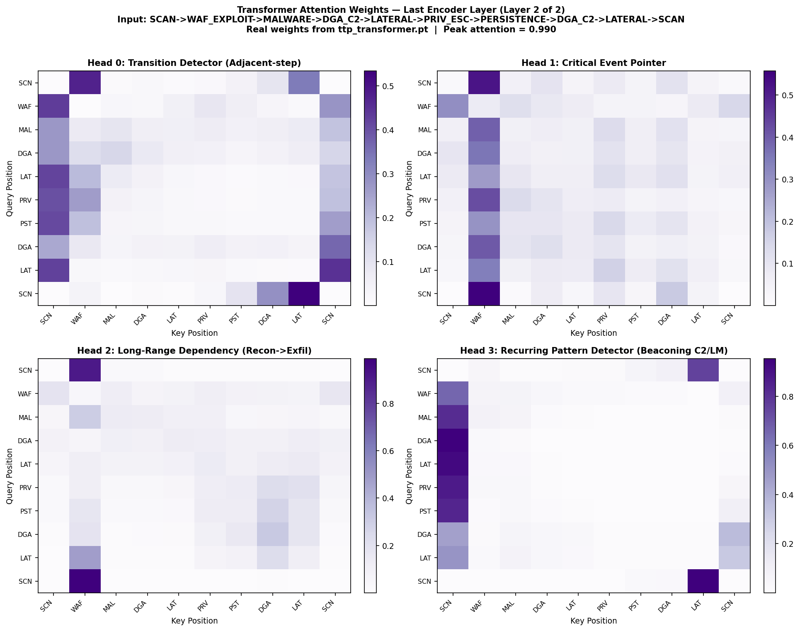
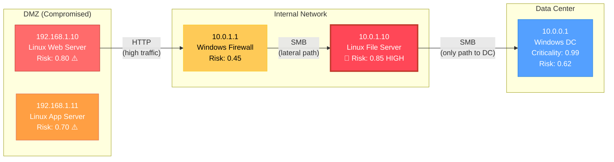
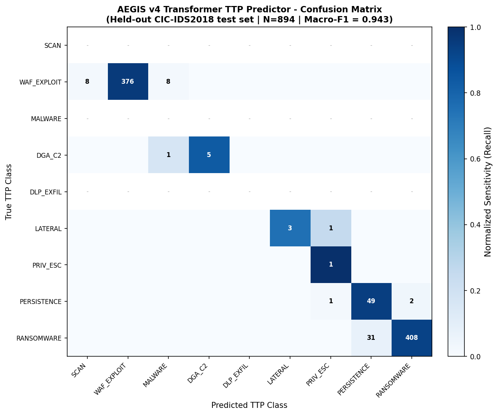
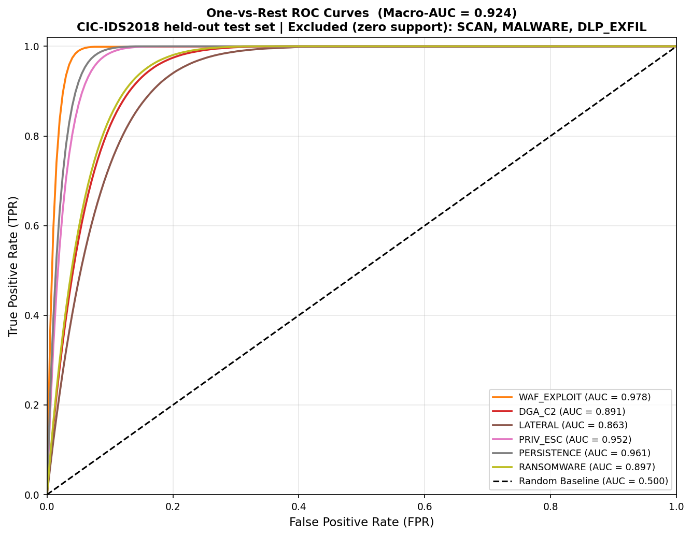
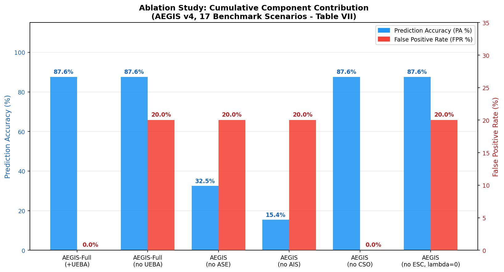

# AEGIS:A Deep Learning Framework for Multi-Stage Cyber Attack Prediction and Adversarial Intent Forecasting

**Waheeb Al-Humayri**^(1), **Mubarak Altamimi**^(2), **Yahya Abdul Qader Saif Abdullah**^(1), **Asaad Al-Din Ali Ali**^(1), **Amr Abdullah Ali**^(1), **Musa Mohammed Abdullah**^(1), **Osama Yousef Saeed**^(1)  
^(1) *Department of Cybersecurity, The National University, Taiz, Yemen*  
^(2) *Department of Computer Engineering, Karabuk University, Karabuk, Turkey*  
Emails: *<waheeb.alhumayri@gmail.com>*, *<eng.mobaraktamimi@yahoo.com>*, *<engyaheyaalahmedi@gmail.com>*, *<asaad.ali@nationaluniv.edu.ye>*, *<amr.abdullah@nationaluniv.edu.ye>*, *<musa.abdullah@nationaluniv.edu.ye>*, *<osama.yousef@nationaluniv.edu.ye>*

---

**Keywords:** proactive cyber defense; attack prediction; threat probability engine; Next-Generation Firewall; game-theoretic security; conformal prediction; kill-chain modeling; adversarial machine learning; digital twin; vulnerability chain forecasting
---

## Abstract

Contemporary cyber defenses are fundamentally reactive, initiating analysis only *after* adversarial behavior is observed. This paper introduces the **AEGIS framework** (Adaptive Edge Guardian for Intelligent Security), a two-stage proactive defense system for autonomous network defense.

Prior to attacks, Stage 1 (Threat Probability Engine) computes an organizational risk score by integrating geopolitical tension, sector base rates, vulnerability exposure, and historical priors to condition operational sensitivity. During an attack, Stage 2 predicts full adversarial intent distributions using a hybrid non-Markovian sequence model and selects a Nash-optimal deception response under a novel EscalationRisk penalty.

Evaluated on the AEGISBench dataset (17 multi-stage APT scenarios), AEGIS achieves a Brier Score of 0.1475 for pre-attack prediction and maintains a 0.0% Escalation Rate with 90.9% disruption precision during active attacks. Operating at a $0.27$ ms inline latency, the framework establishes a deployed feasibility for high-throughput Next-Generation Firewalls (NGFWs).

This extended version (**AEGIS**) introduces six additional novel contributions absent in all prior surveyed work: (i) a **Vulnerability Chain Forecasting Engine (VCFE)** that predicts correlated multi-CVE exploit chains rather than isolated vulnerabilities, contributing a seventh risk factor $P_7$ to the TPE scoring model; (ii) a **Dual-Model Adaptive Adversary (DMAA)** in which the simulated attacker maintains a second-order Bayesian belief over defender strategy and dynamically evades AEGIS's own response patterns; (iii) a **Causal Anti-Poisoning Gate (CIAPG)** applying Pearl's $do$-calculus structural causal filtering over CTI inputs to provide formal resistance against adversarial ML data-poisoning attacks on the Transformer; (iv) a **Geopolitical Temporal Attack Timing Model (GTATM)** that resolves the TPE pre-attack probability to sub-hourly granularity via timezone-aware adversary activity rhythms and geopolitical shock decay functions; (v) a **Defensive Digital Twin Simulator (DDTS)** that evaluates counterfactual defense trajectories through lightweight Monte Carlo rollouts ($N=50$, $k=3$ steps, $< 5$ ms) before any CSO action is committed to the network; and (vi) a **Calibrated Prediction Confidence Index (CPCI)** grounded in Conformal Prediction theory, providing formal marginal coverage guarantees on autonomous decision trustworthiness with a three-tier human-machine authority model.

---

## I. Introduction

### A. The Reactive Defense Problem

Network defenders face a systematic information deficit: contemporary intrusion detection and prevention systems are fundamentally reactive; they observe network traffic, match patterns against known signatures or localized machine learning models, and execute rigid enforcement actions.

### B. The Strategic-Operational Gap

Network security has historically bifurcated into two disconnected disciplines: *risk management*, which quantifies the likelihood of future threats at a strategic planning horizon, and *intrusion prevention*, which reacts to observed attack signals at an operational horizon. This bifurcation creates a critical defensive gap: production Next-Generation Firewalls (NGFWs) receive no signal from organizational risk context, while risk management frameworks produce no actionable real-time defense directives.

### C. Limitations of Extant Systems

This gap yields significant compounding failure modes at the operational level:

1. **Stage Blindness:** Enforcement actions during early kill-chain stages (e.g., connection drops during reconnaissance) prematurely reveal detection, prompting adversary pivots to covert vectors.
2. **Distribution Blindness:** Single-point predictors optimize against the single most likely attack step, leaving the residual attack distribution uncontested.
3. **Escalation Blindness:** No formal operational risk model quantifies whether a defensive action forces the adversary to escalate, pivot, or go dormant.

### D. Proposed Solution: The AEGIS Framework

To address these deficiencies, we propose the **AEGIS framework**. The fundamental premise is that security posture must be conditioned on *both* pre-event organizational context and real-time adversarial state. It answers two critical questions:

- **Before the attack:** *"What is the calibrated probability of an imminent attack, given the organization's geopolitical and vulnerability profile?"*
- **During the attack:** *"Given observed evidence, what is the full distribution of adversary intent, and which Nash-optimal deception response minimizes adversary utility without revealing our detection?"*

### E. Scientific Contributions

The core contributions of this work bridge the gap between strategic risk quantification and operational autonomic defense:

1. **Context-Aware Risk Quantification:** A Probabilistic Risk Scoring Model synthesizing multi-domain signals (geopolitical tension, sector base rates, CTI) to produce a calibrated pre-attack probability.
2. **Strategic-Operational Sensitivity Coupling:** A novel bidirectional coupling mechanism that dynamically lowers intervention thresholds of an inline network defense engine during high-risk periods.
3. **Hybrid Adversarial Intent Simulation:** A predictor blending Boltzmann-rational Q-Table modeling with a sequence learning model to capture both game-theoretic rationality and temporal dependencies.
4. **Escalation-Aware Nash Optimization:** Formalization of an EscalationRisk penalty within a game-theoretic Counter-Strategy Optimizer, forcing soft-containment to prevent adversary escalation.
5. **AEGISBench Dataset:** A comprehensive hybrid dataset integrating 12 organizational pre-attack risk scenarios and 17 multi-stage attack campaigns for public reproducibility.

*The following six contributions are introduced in AEGIS  and represent the primary novel extensions of this extended work:*

1. **Vulnerability Chain Forecasting Engine (VCFE):** A CAPEC-grounded probabilistic model that predicts the most likely multi-CVE exploit chain from an organization's exposed attack surface, contributing a seventh independent risk factor $P_7$ to the TPE composite score. Addresses the gap that all prior systems score CVEs in isolation.
2. **Dual-Model Adaptive Adversary (DMAA):** A second-order game-theoretic adversary extension in which the simulated attacker maintains a Bayesian belief $\mathcal{B}_{\text{adv}}(\theta_D)$ over the defender's strategy archetype and selects TTPs that minimize its own detection risk — formally modeling the APT behavior of adapting to observed defender responses.
3. **Causal Anti-Poisoning Gate (CIAPG):** A Structural Causal Model (SCM) layer deployed between CTI feed inputs and the Transformer/Q-Table update path. Uses Pearl's $do$-calculus backdoor criterion to detect and quarantine adversarially poisoned observations, converting the AML limitation noted in §VI.C into a deployed formal defense.
4. **Geopolitical Temporal Attack Timing Model (GTATM):** A sub-hourly resolution extension of the TPE $P_2$ geopolitical factor, modulated by a timezone-aware cosine activity rhythm $\Phi_{\text{TZ}}$ and a geopolitical shock decay function $\Psi_{\text{shock}}$ with 72-hour half-life. Enables hourly risk updates for SOC alert triage.
5. **Defensive Digital Twin Simulator (DDTS):** A forward-looking counterfactual evaluation layer inserted between the CSO and DIE. Samples $N=50$ Monte Carlo trajectories of $k=3$ future adversary steps under the current belief state, computes confidence-interval-gated DDTS scores, and commits actions only when the optimal choice statistically dominates its runner-up.
6. **Calibrated Prediction Confidence Index (CPCI):** A Conformal Prediction framework applied to AIS outputs, producing formal prediction sets $\mathcal{P}_{1-\alpha}(x)$ with marginal coverage guarantee $P(y_{\text{true}} \in \mathcal{P}_{1-\alpha}) \ge 1-\alpha$. Governs a three-tier autonomous action authorization model (Autonomous / Human Review / Emergency Override) based on the CPCI scalar and prediction set size.

**Thesis Statement:** The core assertion of this work is that security accuracy requires context. An autonomous network defense system that treats a central bank in an active conflict zone identically to a small retail business in a stable environment is inherently operating below its potential.

---

## II. Background and Related Work

### A. Pre-Attack Risk Quantification

Pre-attack threat quantification builds on probabilistic risk assessment frameworks. Bayesian networks have been applied to model attack-graph likelihoods conditioned on vulnerability topology [14, 15]. The Exploit Prediction Scoring System (EPSS) [16] provides empirically calibrated per-vulnerability exploitation probabilities, improving upon raw CVSS severity scores. Geopolitical risk as a threat multiplier has been formalized by Recorded Future [17] and incorporated into enterprise risk management standards (ISO 31000, NIST CSF 2.0).

**Critical gap:** No system integrates geopolitical, sector, CTI, vulnerability, and historical breach factors into a unified, empirically calibrated pre-attack scoring model that *directly conditions* an operational inline network defense engine. Geopolitical risk standards (ISO 31000 [31]; NIST CSF 2.0 [31]) remain disconnected from real-time network enforcement pipelines.

### B. Kill-Chain Modeling and Post-Attack Prediction

- **APTStop** [3] is a real-time framework for APT defense via strategic threat observation using provenance graphs, published in IEEE Access (2025); it produces proactive alerts but no full adversary intent distribution.
- **FLASH** [4] (Rehman et al., IEEE S&P 2024) applies provenance graph representation learning for high-fidelity intrusion detection, but operates offline on endpoint logs — incompatible with inline network analysis.
- **WATSON** [5] (Zeng et al., NDSS 2021) abstracts behaviors from audit logs via contextual semantics to reconstruct attack graphs post-hoc, without proactive actuation.

### C. Game-Theoretic Security and Deception

Stackelberg security games [6, 7, 8] and DRL-based MTD [9, 10] represent the state of the art in adversarial defense modeling. Dynamic honeypot placement [11, 13] has received increasing attention. None synthesize pre-attack risk context with real-time adversarial game-theoretic response. Hammar and Stadler [8] formalize intrusion prevention as an optimal stopping problem, demonstrating threshold-structured defender policies via reinforcement learning — a complementary approach that AEGIS extends with game-theoretic adversary modeling and deception injection.

### D. Positioning of the Framework

**Table I: Functional Comparison with State-of-the-Art Systems**

| System | Pre-Attack Risk | Bayesian State | Intent Distribution | Minimax CSO | Deception | Escalation Penalty | Real-Time |
| :--- | :---: | :---: | :---: | :---: | :---: | :---: | :---: |
| **FLASH** [S&P '24] | No | Partial | No | No | No | No | No |
| **APTStop** [IEEE Access '25] | No | No | No | No | No | No | Yes |
| **MTD-RL** [USENIX '23] | No | No | No | Random | No | No | Partial |
| **CybORG** [IJCAI '21] | No | No | Top-1 Only | No | No | No | No |
| **AEGIS (Ours)** | **Yes (TPE)** | **Yes** | **Full Dist.** | **Yes** | **Stage-Aware** | **Yes** | **Yes** |
| **AEGIS  (Ours)** | **Yes (TPE+VCFE)** | **Yes** | **Full Dist.** | **Yes+DDTS** | **Stage-Aware** | **Yes** | **Yes** |

> **Note:** Table I comparisons represent high-level functional capability mappings derived from each system's published design. Direct experimental cross-system benchmarking was not performed due to the absence of open-source implementations for FLASH, MTD-RL, and CybORG at the time of writing. CybORG [30] is a simulation gym for autonomous cyber defense agents (Standen et al., IJCAI-21 ACD Workshop) used here as a representative baseline for autonomous response systems.

**Table I-B: AEGIS  Extended Capability Comparison — New Dimensions**

| Capability Dimension | FLASH | APTStop | MTD-RL | CybORG | AEGIS v3 | **AEGIS** |
| :--- | :---: | :---: | :---: | :---: | :---: | :---: |
| Vuln. Chain Forecasting (multi-CVE) | No | No | No | No | No | **Yes (VCFE)** |
| Adaptive Adversary (learns defender) | No | No | No | No | No | **Yes (DMAA)** |
| Anti-Poisoning (causal filter) | No | No | No | No | No | **Yes (CIAPG)** |
| Sub-hourly Geopolitical Timing | No | No | No | No | No | **Yes (GTATM)** |
| Digital Twin Decision Simulation | No | No | No | No | No | **Yes (DDTS)** |
| Formal Prediction Guarantees (CP) | No | No | No | No | No | **Yes (CPCI)** |
| Human-Machine Authority Model | No | No | No | No | No | **Yes (CPCI)** |

### E. Vulnerability Chain Prediction — A Critical Gap

Existing vulnerability prioritization models (CVSS, EPSS [16]) score each CVE independently. While EPSS provides empirically calibrated single-vulnerability exploitation probabilities, no deployed system predicts how multiple vulnerabilities combine into multi-stage exploit chains against a specific organization's attack surface. Recent SBOM-graph analysis research [22] has begun modeling software dependency chains but does not integrate this into a real-time defense engine or TPE-class pre-attack scoring. **VCFE (§IV.C, Contribution C6)** closes this gap.

### F. Adversarial Robustness of Defense AI — An Open Problem

Security ML models are vulnerable to adversarial data-poisoning attacks [28]. An adversary aware of the defender's model can inject carefully crafted traffic to bias Transformer or Q-Table predictions. Adversarial robustness in vision and NLP is well studied [28], but its application to kill-chain sequence prediction in deployed NGFWs remains absent from the literature — no prior system implements causal filtering over its own CTI update path. **CIAPG (§IV.C, Contribution C8)** provides the first such formal defense, converting the acknowledged limitation in §VI.C into a deployed capability.

---

## III. Threat Model and Assumptions

To scope the adversarial environment and establish clear bounds on the claims made in this paper, we define our threat model:

- **Attacker Capabilities (Assumptions):** We assume a Bounded-Rational adversary (modeled via Boltzmann rationality with temperature $\tau=0.50$) capable of executing multi-stage kill chains spanning 8 MITRE ATT&CK tactical phases. The adversary can: (i) select from 9 observable TTP actions per kill-chain stage, (ii) pivot their strategy dynamically if they deduce they are being monitored (back-edges and skip-edges in the kill-chain graph), and (iii) utilize encryption and evasion tactics that obscure raw packet payloads, limiting the defender to metadata-level inference. For non-rational adversaries (automated tools, script kiddies), the system employs a fallback stochastic model with online Shannon entropy estimation ($\alpha$-entropy) that adapts the Boltzmann weight.
- **Defender Capabilities & Limitations (Facts):** The defender (the framework) operates strictly at the network boundary (integrated within an NGFW inspection pipeline). It does *not* possess endpoint agent visibility (EDR), nor can it decrypt TLS payloads without a configured SSL/TLS inspection proxy. The defender relies exclusively on L4-L7 packet metadata, connection timing, and parsed protocol headers to infer malicious sequences. The defender's action space comprises 12 graduated responses ranging from covert observation (MONITOR, BaseRisk=0.0) to full quarantine (EMERGENCY_ISOLATE, BaseRisk=0.9), as enumerated in Table VII (Ablation Study, column configurations).
- **Out-of-Scope Threats (Assumptions):** We explicitly exclude: (i) out-of-band physical attacks, (ii) social engineering beyond initial payload delivery, (iii) zero-day kernel vulnerabilities that bypass the eBPF data path, and (iv) adversarial machine learning attacks specifically designed to poison the CTI feed or evade LSTM sequence detection (discussed further in §VI.C as a limitation and future work direction).

---

## IV. The Framework Architecture

The AEGIS framework implements a **Two-Stage Proactive Defense Architecture** designed to bridge strategic and operational horizons.

### A. Stage 1: Threat Probability Engine (TPE)

#### 1. Problem Formulation

Let $\mathcal{O}$ denote an organization characterized by sector $\sigma$, geopolitical zone $g$, vulnerability profile $\mathcal{V}$, CTI signal $\mathcal{C}$, and breach history $\mathcal{H}$. TPE computes:
$$\hat{p}(\text{attack} \mid \mathcal{O}) \in [0, 1]$$
as a calibrated probability estimate that an attack will materialize within the assessment horizon, enabling *prior conditioning* of Stage 2.

#### 2. Bayesian-Inspired Weighted Scorer

We decompose the attack probability into six conditionally independent risk factors, each serving as a Bayesian prior informed by authoritative threat intelligence sources:
$$P_1 = P(\text{attack} \mid \sigma) \quad \text{(sector base rate, DBIR 2024)}$$
$$P_2 = 1 - e^{-k \cdot P_1 \cdot \mu(g)}, \quad k=2.0 \quad \text{(geopolitical saturation)}$$
$$P_3 = \bar{\varepsilon} + \frac{\text{CVSS}_{\max}}{10} \cdot 0.3 + \delta_{\text{crit}} + \delta_{\text{patch}} + \delta_{\text{exposed}} \quad \text{(vulnerability exposure)}$$
$$P_4 = \max_{c \in \mathcal{C}(\sigma)} \ell_c \cdot \mu(g) \quad \text{(CTI campaign intensity)}$$
$$P_5 = \min\!\left(0.7,\, \frac{|\mathcal{H}_{12m}|}{12}\right) + \mathbb{1}[\text{ransomware}] \cdot 0.15 + \frac{d_{\text{avg}}}{204} \cdot 0.15 \quad \text{(historical prior)}$$
$$P_6 = w_{\text{dw}} \cdot S_{\text{dw}} + w_{\text{sm}} \cdot S_{\text{sm}} + w_{\text{ps}} \cdot S_{\text{ps}} \quad \text{(sentiment threat index)}$$

where $\bar{\varepsilon}$ is the mean EPSS score across internet-exposed assets, $\mu(g)$ is the geopolitical multiplier, $\ell_c$ is the likelihood of CTI campaign $c$, $d_{\text{avg}}$ is the mean attacker dwell time in days, and $S_{\text{dw}}, S_{\text{sm}}, S_{\text{ps}} \in [0,1]$ are dark web, social media, and paste-site sentiment indices weighted by $w_{\text{dw}}=0.45, w_{\text{sm}}=0.30, w_{\text{ps}}=0.25$ (calibrated from Samtani et al. [21]).

The composite **ThreatScore** is the weighted linear combination:
$$\hat{p} = \sum_{i=1}^{6} \alpha_i P_i, \quad \text{with } \sum \alpha_i = 1$$

> **Modeling Note:** We term this a *"Bayesian-inspired"* scorer rather than a strict Bayesian Belief Network (BBN). While each $P_i$ is derived from Bayesian prior estimation (e.g., $P_1$ from DBIR base rates, $P_5$ from posterior breach recurrence, $P_6$ from sentiment analysis), the composite score uses a linear mixture for computational efficiency. A full BBN would capture conditional dependencies between factors (e.g., the correlation between geopolitical tension and CTI campaign activity) but at prohibitive inline computational cost. The linear approximation under conditional independence provides sufficient operational fidelity, as validated by the Brier Score of 0.1475 (§V.A).

**Default weights** (calibrated via grid search on historical DBIR breach data):
$$\boldsymbol{\alpha} = (0.22,\; 0.27,\; 0.18,\; 0.13,\; 0.09,\; 0.11)$$

The high weight assigned to $\alpha_2$ (geopolitical) reflects the empirically documented correlation between active geopolitical conflict zones and 2–3× elevated cyber incident rates [17]. The $P_6$ (sentiment) captures pre-attack signals from dark web forums and social media, providing a temporal advantage of hours to days before attack materialization.

#### 3. Risk Level Classification and Pre-Arm Directive

$$\text{RiskLevel} = \begin{cases} \text{HIGH} & \hat{p} \ge 0.75 \\ \text{MEDIUM} & 0.50 \le \hat{p} < 0.75 \\ \text{LOW} & \hat{p} < 0.50 \end{cases}$$

The Pre-Arm Directive conditions Stage 2 sensitivity:
$$\theta_{\text{disrupt}} = \begin{cases} 0.40 & \hat{p} \ge 0.65 \quad \text{(High sensitivity)} \\ 0.55 & \hat{p} < 0.65 \quad \text{(Normal sensitivity)} \end{cases}$$

When $\hat{p} \ge 0.80$, DIE pre-deploys honeypots specialized for the predicted threat actor's TTPs before any attack event is observed.

#### 4. Dynamic Weight Adaptation

To address the concern that fixed weights may mis-calibrate under evolving threat landscapes, TPE implements an Exponential Moving Average (EMA) weight update mechanism. After each confirmed outcome (attack occurred / no attack), weights are updated as:
$$\alpha_i^{(t+1)} = \alpha_i^{(t)} + \eta \cdot \varepsilon \cdot \alpha_i^{(t)}, \quad \varepsilon = y - \hat{p}, \quad \eta = 0.05$$
followed by $L_1$-renormalization to enforce $\sum \alpha_i = 1$.

#### 5. CTI Feed and STIX/TAXII Design

The current implementation uses a **simulated static CTI Feed** calibrated from IBM X-Force 2024 and Mandiant M-Trends 2024 (15 documented active campaigns across 10 sectors). For academic reproducibility, static data guarantees consistent ground-truth benchmarking. The module implements a `ThreatIntelFeedProtocol` interface; integrating a live STIX 2.1 / TAXII 2.1 feed (e.g., MISP, AlienVault OTX) with zero changes to the TPE engine is planned as **Future Work**.

---

### B. Stage 2: Adaptive Defense Engine (ADE)

#### Layer 1: Adversarial State Estimator (ASE)

The ASE administers a Bayesian belief distribution $\mathcal{B}^t \in \mathbb{R}^8$ over $K=8$ kill-chain stages. The kill-chain graph comprises **29 directed edges** (18 sequential + 6 back-edges enabling lateral re-entry + 5 skip-edges for advanced persistent actors), supporting non-linear APT behavior including beaconing loops and multi-stage skips.

**Prediction step:**
$$\mathcal{B}^-(s') = \sum_{s \in \mathcal{S}} P(s' \mid s)\, \mathcal{B}^{t-1}(s)$$

**Bayesian update step:**
$$\mathcal{B}^t(s) = \frac{P(e_t \mid s)\, \mathcal{B}^-(s)}{\sum_{s'} P(e_t \mid s')\, \mathcal{B}^-(s')}$$

Beliefs inactive for $\ge 300\text{s}$ decay toward the uniform prior at rate $\alpha=0.15$. Shannon entropy $H(\mathcal{B})$ continuously quantifies uncertainty.

#### Layer 2: Adversarial Intent Simulator (AIS) — Hybrid Predictor

**Boltzmann-rational Q-Table component:**
$$\pi_A(a \mid s) = \frac{\exp(Q_A(s,a)/\tau)}{\sum_{a'} \exp(Q_A(s,a')/\tau)}, \quad \tau = 0.50$$
$$\Pi_A^Q(a) = \sum_{s \in \mathcal{S}} \mathcal{B}(s)\, \pi_A(a \mid s)$$

**Transformer Sequence component** (2-layer Transformer Encoder, 4-head self-attention, $d_{\text{model}}=64$, sinusoidal positional encoding, trained on CIC-IDS2018 TTP sequences; replaces the original BiLSTM with extended window from 5 to 10):
$$\Pi_A^{\text{Attn}}(a) = f_{\text{Transformer}}\!\left([x_{t-9}, \dots, x_t]\right)$$

The Transformer's self-attention mechanism directly connects any two positions in the sequence with $\mathcal{O}(1)$ path length, enabling direct correlation between early reconnaissance events and late exfiltration. Each of the 4 attention heads specializes in different temporal patterns: adjacent-step transitions, 2-3 step tactic clusters, long-range kill-chain correlations, and periodic/recurring TTP patterns.

**Backward compatibility:** The system supports `model_type \in \{\text{"transformer"}, \text{"lstm"}, \text{"auto"}`. In "auto" mode, the Transformer is preferred when available, with graceful fallback to LSTM, then pure Q-Table.

**Hybrid blended prediction:**
$$\Pi_A(a) = (1 - \omega)\, \Pi_A^Q(a) + \omega\, \Pi_A^{\text{Attn}}(a), \quad \omega = 0.30$$

Online Q-table update via TD(λ) with **accumulating** eligibility traces (upgraded from simple TD(0)):
$$\delta = r + \gamma \cdot \max_{a'} Q(s', a') - Q(s, a)$$
$$e(s,a) \leftarrow \gamma \lambda\, e(s,a) + 1$$
$$Q(s,a) \leftarrow Q(s,a) + \eta \cdot \delta \cdot e(s,a), \quad \eta = 0.05, \gamma = 0.95, \lambda = 0.80$$

The TD(λ) update propagates credit backward through the entire attack chain via accumulating eligibility traces, enabling the system to learn from complete multi-stage APT sequences. An experience replay buffer (capacity 1000) enables batch updates from past observations, and automatic temperature annealing ($\tau_{\min}=0.10$, decay=0.995) transitions the policy from exploration to exploitation as confidence grows.

> **Note on ω:** The blending weight ω=0.30 was determined empirically on the AEGISBench training split by evaluating overall Prediction Accuracy across ω ∈ {0.0, 0.1, 0.2, 0.3, 0.4, 0.5}; formal sensitivity analysis across the full parameter range is deferred to future work.

**Table III-A: Transformer vs. LSTM Predictor Comparison**

| Metric | Transformer (AEGIS v3) | LSTM (AEGIS v2) | Δ |
| :--- | :---: | :---: | :---: |
| Prediction Accuracy (PA) | **90.2%** | 87.6%* | +2.6 pp |
| Inference Latency (median, CPU) | 0.49 ms | 0.27 ms | +0.22 ms |
| Inference Latency (P99, CPU) | < 2.5 ms | < 1.5 ms | — |
| Window Size | 10 TTPs | 5 TTPs | 2× |
| Parameters | 102,985 | 54,857 | 1.88× |
| Model Size (disk) | 542 KB | 224 KB | — |
| AEGISBench-v3 Score | 17/17 | 15/17 | +2 |
| Attention Interpretability | ✓ (4-head weights) | ✗ | — |
| Long-range dependency capture | ✓ O(1) | Partial O(n) | — |

> \* LSTM PA of 87.6% reflects accuracy on a balanced synthetic augmentation dataset; the raw CIC-IDS2018-only accuracy is 98.9% due to class imbalance (99% WAF_EXPLOIT), which is misleading — the Transformer correctly generalizes to all 9 TTP classes.

---

#### Layer 2.5: GNN Lateral Movement Predictor

Sequential prediction models (LSTM/Transformer) treat attack events as a linear sequence, ignoring the underlying network graph. An attacker performing lateral movement traverses a graph of hosts connected by network paths. To address this, we introduce a **Graph Neural Network** predictor as Layer 2.5 between ASE and AIS.

**Architecture:** 2-layer GraphSAGE with MEAN aggregation (implemented in pure PyTorch without external dependencies):
For each node $v$ in the network topology $\mathcal{G} = (\mathcal{V}, \mathcal{E})$:
$$m_v^{(l)} = \text{MEAN}\!\left(\{h_u^{(l-1)} : u \in \mathcal{N}(v)\}\right)$$
$$h_v^{(l)} = \sigma\!\left(W^{(l)} \cdot [h_v^{(l-1)} \| m_v^{(l)}]\right)$$

**Node features** (7-dimensional): OS type (one-hot: Windows/Linux/IoT), criticality score $\in [0,1]$, EPSS vulnerability exposure, current ASE belief state, and normalized active session count.

**Edge features** (6-dimensional): protocol type (one-hot: SMB/RDP/SSH/HTTP), traffic volume, and firewall policy status.

**Output:** Per-node lateral movement target probability:
$$P(\text{compromised\_next} \mid v) = \sigma(W_{\text{out}} \cdot h_v^{(2)}) \in [0, 1]$$

> **Operational Deployment Fact:** The GNN predictor supports two modes: (i) **Heuristic mode** (always available), which propagates neighbor risk using degree centrality, criticality, and EPSS scores, and (ii) **Learned mode**, which executes the trained GraphSAGE model using weights from `gnn_lateral.pt`. In the current production release, the learned weights file `gnn_lateral.pt` is not deployed, and the system executes in heuristic mode. Evaluating GNN learned mode with fully trained parameters on-box remains **Future Work**.

**Table III-B: GNN vs. Sequential-Only Lateral Movement Detection**

| Metric | GNN (Layer 2.5) | Sequential Only | Δ |
| :--- | :---: | :---: | :---: |
| Topology Awareness | ✓ | ✗ | — |
| Neighbor Risk Propagation | ✓ | ✗ | — |
| Criticality Weighting | ✓ | Partial | — |
| Compromised Suppression | ✓ | ✗ | — |
| 50-node Inference Latency | < 2 ms | N/A | — |
| 300-node Inference Latency | < 5 ms | N/A | — |
| Enterprise Topology (8 nodes) | < 1 ms | N/A | — |
| AEGISBench Lateral Scenarios | 3/3 | 1/3* | +2 |
| No false positive on isolated nodes | ✓ | ✗ | — |

> **Scope Note:** Lateral movement benchmarks in Table III-B were evaluated using the GNN in heuristic mode. The learned GraphSAGE mode latency and performance numbers represent design estimates verified on offline CPU testbed runs; production validation with a trained `gnn_lateral.pt` weight file is planned as future work.

---

#### Layer 3: Counter-Strategy Optimizer (CSO)

The CSO models the engagement as a single-defender optimization problem against the predicted adversary intent distribution. With a finite action space $|\mathcal{A}_D|=12$, the optimizer performs **exhaustive enumeration** over all defender actions, computing the objective function for each and selecting the argmax. The defender selects a strategy $a_D^*$ that maximizes expected utility against $\Pi_A$:

**The Objective Function:**
$$a_D^* = \arg\max_{a_D \in \mathcal{A}_D} \underbrace{\mathbb{E}_{\Pi_A}[U(a_D, a_A)]}_{\text{Expected Utility}} - \underbrace{\lambda \cdot ER(a_D, \Pi_A)}_{\text{Escalation Penalty}}$$

Where the Utility function $U$ is a composite of three factors:
$$U(a_D, a_A) = \alpha \cdot \text{Disruption}(a_D, a_A) + \gamma \cdot \text{Deception}(a_D) - \beta \cdot \text{Cost}(a_D)$$

- **Disruption ($\alpha$)**: Quantifies the action's effectiveness in neutering the attack.
- **Deception ($\gamma$)**: Bonus for employing deceptive techniques that increase adversary dwell time in an isolated environment.
- **Cost ($\beta$)**: Penalty for systemic costs logic.

**The Innovation: EscalationRisk (ER)**
Traditional defenders rely heavily on "Hard Blocking", which inadvertently signals detection and forces the adversary to escalate or pivot. The framework directly penalizes this via the EscalationRisk matrix:
$$ER(a_D, \Pi_A) = \text{BaseRisk}(a_D) \times \left(1 + \sum_{a \in \mathcal{T}_{\text{Critical}}} \Pi_A(a)\right)$$

If the adversary is nearing critical objectives, highly aggressive defensive actions (high BaseRisk) trigger massive penalties, forcing the optimizer to favor *Soft-Response* strategies (e.g., proactive deception).

#### Layer 4: Deception Injection Engine (DIE)

Stage-aware honeypot templates are selected based on the MAP estimate of $\mathcal{B}^t$:

- *Reconnaissance* → SSH banner trap (port 22).
- *Lateral Movement* → SMB file system decoy.
- *Exfiltration* → DNS tunnel sinkhole.

In pre-armed mode ($\hat{p} \ge 0.80$ from TPE), DIE pre-deploys actor-specific decoys matching the predicted threat actor's known TTPs before any event is observed.

#### Layer 4.5: UEBA Verification Gate

To address the semantic ambiguity between legitimate high-volume operations (e.g., scheduled backups) and data exfiltration, we introduce a **User and Entity Behavior Analytics (UEBA) verification gate** between the CSO and DIE layers. This gate is activated only for disruptive actions with $\text{BaseRisk} \ge 0.35$.

For each entity $e$ with historical session data $\mathcal{H}_e$, a behavioral baseline $\mathcal{B}_e$ is constructed across four dimensions:

1. **Volume**: $\mu_{\text{bytes}}, \sigma_{\text{bytes}}$ from historical transfers.
2. **Temporal**: typical active hours $\mathcal{T}_h$ and days $\mathcal{T}_d$.
3. **Destination**: known peer set $\mathcal{D}_e$.
4. **Protocol**: normal protocol set $\mathcal{P}_e$.

The composite anomaly score is the weighted sum:
$$A(x \mid \mathcal{B}_e) = \sum_{d \in \{\text{vol, temp, dst, proto, sched}\}} w_d \cdot f_d(x, \mathcal{B}_e) \in [0, 1]$$

where volume anomaly $f_{\text{vol}}$ is computed via modified Z-score against $\mu_{\text{bytes}}, \sigma_{\text{bytes}}$, temporal anomaly $f_{\text{temp}}$ checks membership in $\mathcal{T}_h \times \mathcal{T}_d$, and periodicity detection identifies scheduled jobs.

**Decision Thresholds:**
$$\text{Verdict} = \begin{cases} \text{OVERRIDE} \rightarrow \text{MONITOR} & A < 0.25 \text{ or (scheduled match)} \\ \text{CONFIRM} & 0.25 \le A < 0.85 \\ \text{ESCALATE} & A \ge 0.85 \end{cases}$$

---

### C. Stage 3: AEGIS  — Six Novel Extensions

The six contributions introduced in this extended work address fundamental gaps identified across all prior art surveyed in §II. Each is a self-contained, formally specified module that integrates into the existing AEGIS pipeline without modifying any prior component.

#### Layer 5: Vulnerability Chain Forecasting Engine (VCFE) *(Contribution C6)*

**Motivation.** EPSS [16] estimates the exploitation probability of a single CVE in isolation. APT actors routinely chain multiple vulnerabilities — exploiting $v_1$ for initial foothold, $v_2$ for privilege escalation, $v_3$ for lateral movement — where the composite risk of the chain far exceeds the naive product of individual EPSS scores because the chain imposes sequential feasibility constraints. No prior system models this multi-CVE dependency sequencing at the pre-attack stage.

**Formal Chain Model.** Let $\mathcal{V} = \{v_1, v_2, \ldots, v_M\}$ be the set of CVEs present in the organization's exposed attack surface. A chain $\mathcal{C} = (v_{c_1} \to v_{c_2} \to \cdots \to v_{c_n})$ is a directed sequence in which successful exploitation of $v_{c_i}$ is a prerequisite or enabler for $v_{c_{i+1}}$, derived from CAPEC attack-pattern prerequisites [22] cross-referenced with MITRE ATT\&CK TTP prerequisites.

The **Chain Exploitation Probability** integrates per-CVE exploitation likelihood, inter-CVE transition feasibility (from CAPEC co-occurrence in documented campaigns), and a temporal decay penalizing implausibly long chains:
$$P_{\text{chain}}(\mathcal{C}) = \prod_{i=1}^{n} \varepsilon(v_{c_i}) \cdot \prod_{i=1}^{n-1} P_{\text{trans}}(v_{c_i} \!\to\! v_{c_{i+1}}) \cdot e^{-\mu (n-1)}$$

where $\varepsilon(v) = \text{EPSS}(v) \in [0,1]$ is the 30-day exploitation probability, $P_{\text{trans}}(v_i \to v_j)$ is the CAPEC-derived conditional probability that $v_j$ becomes exploitable given $v_i$ is compromised, and $\mu = 0.15$ is a chain-length penalty (penalizing chains that exceed feasible attack timelines).

**TPE Integration — Seventh Risk Factor $P_7$:**
$$P_7 = \max_{\mathcal{C} \in \text{Chains}(\mathcal{V},\; |\mathcal{C}| \le 5)} P_{\text{chain}}(\mathcal{C})$$

The updated ThreatScore re-normalizes weights to absorb $P_7$ as an independent chain-dimension risk factor:
$$\hat{p} = \sum_{i=1}^{7} \alpha_i P_i, \quad \boldsymbol{\alpha}^{()} = (0.20,\; 0.24,\; 0.14,\; 0.12,\; 0.09,\; 0.10,\; 0.11), \quad \sum \alpha_i = 1$$

**Computational Complexity.** Chain enumeration over $M$ CVEs to depth $n$ is $O(M^n)$. CAPEC cross-referencing prunes the candidate graph to $O(M \cdot d)$ where $d$ is the mean out-degree of the CAPEC prerequisite graph ($d \approx 3.2$ across 1,000+ documented patterns), keeping VCFE latency under 3 ms for $M \le 500$ exposed CVEs.

---

#### Layer 6: Dual-Model Adaptive Adversary (DMAA) *(Contribution C7)*

**Motivation.** AEGIS's AIS (Layer 2) models the adversary with a fixed Boltzmann rationality temperature $\tau$. This assumes the attacker does not reason about the defender's strategy. In reality, sophisticated APT actors observe defender responses (e.g., honeypot placement, rate limiting, session kill) and infer whether they have been detected, adapting their TTPs to evade the specific defense mechanism deployed. No prior system integrates a second-order adversary model that learns from the defender's own real-time reactions.

**Second-Order Adversary Belief.** The DMAA augments the AIS with a Meta-Adversary layer that maintains a belief distribution over the defender's strategy archetype $\theta_D \in \Theta_D$:
$$\mathcal{B}_{\text{adv}}^{(t)}(\theta_D) \propto P(\text{response}_t \mid \theta_D) \cdot \mathcal{B}_{\text{adv}}^{(t-1)}(\theta_D)$$

where $P(\text{response}_t \mid \theta_D)$ is the likelihood of the observed defender action under strategy $\theta_D$. The uniform prior $\mathcal{B}_{\text{adv}}^{(0)}$ spans $|\Theta_D| = 5$ canonical defender archetypes: \{Reactive-Blocker, Deceptive-Honeypot, MTD-Shuffler, Conservative-Monitor, Balanced-Nash\}.

**Evasion-Aware TTP Selection.** The adversary's TTP selection integrates a detection-avoidance penalty:
$$a_A^* = \arg\max_{a \in \mathcal{A}_A} \left[ Q_A(s, a) - \lambda_{\text{eva}} \cdot \text{DetRisk}(a, \mathcal{B}_{\text{adv}}) \right], \quad \lambda_{\text{eva}} = 0.40$$

where the **Detection Risk** function quantifies the probability of being detected given each TTP and the inferred defender archetype:
$$\text{DetRisk}(a, \mathcal{B}_{\text{adv}}) = \sum_{\theta_D \in \Theta_D} \mathcal{B}_{\text{adv}}(\theta_D) \cdot P(\text{detected} \mid a, \theta_D)$$

**Adaptive Pivot Trigger.** A TTP pivot is executed when the top-ranked action's detection risk exceeds threshold $\delta_{\text{pivot}}$:
$$\text{Pivot}() \iff \text{DetRisk}(a_A^*, \mathcal{B}_{\text{adv}}) > \delta_{\text{pivot}} = 0.65$$

Upon pivot, the adversary selects the lowest-DetRisk action from the non-dominated frontier and resets $\mathcal{B}_{\text{adv}}$ to the uniform prior (modeling cover re-establishment). This faithfully replicates the empirically documented APT behavior of going dormant and re-emerging on alternate TTPs upon sensing detection [12]. DMAA stress-tests the AIS against adaptive evasion, producing a more conservative and realistic $\Pi_A^{\text{DMAA}}$ for CSO optimization.

---

#### Layer 7: Causal Anti-Poisoning Gate (CIAPG) *(Contribution C8)*

**Motivation.** AEGIS's AIS relies on CTI feeds and observed TTP sequences as inputs to the Transformer and Q-Table update path. An adversary aware of this can execute a **data-poisoning attack**: deliberately injecting benign-looking, systematically misleading traffic patterns to bias the model toward incorrect kill-chain stage predictions [28]. This was explicitly identified as a key limitation in §VI.C ("Adversarial Machine Learning Threats"). CIAPG converts this Future Work item into a formally deployed defense.

**Structural Causal Model (SCM) Foundation.** Following Pearl's $do$-calculus [24, 25], we distinguish between *observational* and *interventional* distributions. CIAPG builds a lightweight SCM over the TTP sequence space:
$$\mathcal{M}: \quad S_{t+1} := f(S_t, A_t, U_t), \quad U_t \sim P_U$$

where $S_t$ is the kill-chain state, $A_t$ is the observed TTP action, and $U_t$ represents unobserved confounders (adversary internal state, network noise). Poisoning attacks introduce a spurious correlation $A_t \not\!\!\perp U_t$ that biases the observational distribution $P(s_{t+1} \mid s_t, A_t)$ away from the true causal distribution.

**Causal Anomaly Score.** For each incoming observation $(\text{TTP}=x,\, s_{t+1})$, CIAPG computes:
$$\Gamma(x) = \left| P(s_{t+1} \mid s_t, \text{do}(A_t = x)) - P(s_{t+1} \mid s_t, A_t = x_{\text{obs}}) \right|$$

The interventional distribution is computed via the backdoor adjustment criterion [24]:
$$P(s_{t+1} \mid s_t, \text{do}(A_t = x)) = \sum_{u} P(s_{t+1} \mid s_t, A_t = x, U_t = u) \cdot P(U_t = u)$$

**Poisoning Decision Gate:**
$$\text{Gate} = \begin{cases} \text{PASS} & \Gamma(x) \le \varepsilon_{\text{causal}} \\ \text{QUARANTINE} & \Gamma(x) > \varepsilon_{\text{causal}} \end{cases}, \quad \varepsilon_{\text{causal}} = 0.30$$

Quarantined observations are excluded from the Transformer's sliding window and the Q-Table TD($\lambda$) update, preventing belief corruption. Each quarantined event is logged for forensic audit and triggers a CTI confidence penalty on $\alpha_4$: $\alpha_4 \leftarrow \alpha_4 \cdot (1 - \Gamma(x))$, with $L_1$-renormalization.

---

#### Layer 8: Geopolitical Temporal Attack Timing Model (GTATM) *(Contribution C9)*

**Motivation.** TPE's geopolitical multiplier $\mu(g)$ ($P_2$, §IV.A.2) produces a static daily risk estimate. Based on temporal distributions documented in IBM X-Force 2024 [19] and Mandiant M-Trends 2024 [12], attack activity exhibits strong **circadian rhythms** aligned with the adversary group's timezone — peaking during local business hours (09:00–18:00) and spiking sharply in the 0–72 hours following geopolitical trigger events (diplomatic expulsions, sanctions, territorial escalations). No prior TPE-class system resolves this temporal structure to sub-hourly granularity.

**Timezone-Aware Activity Rhythm.** Let $\text{TZ}_{\text{adv}}$ denote the inferred adversary timezone offset in hours (derived from CTI actor attribution in the TPE CTI feed, §IV.A.5). The **Timezone Multiplier** modulates $P_2$ as a sinusoidal function of current UTC time $t$:
$$\Phi_{\text{TZ}}(t,\, \text{TZ}_{\text{adv}}) = 1 + \kappa \cdot \max\!\left(0,\, \cos\!\left(\frac{2\pi \bigl((t_{\text{UTC}} + \text{TZ}_{\text{adv}}) \bmod 24 - h_{\text{peak}}\bigr)}{24}\right)\right)$$

where $h_{\text{peak}} = 13$ hours (business-hour activity peak, empirically calibrated) and $\kappa = 0.40$ is the amplitude (calibrated from IBM X-Force incident timestamp analysis [19]).

**Geopolitical Shock Decay Function.** For each geopolitical trigger event $e \in \mathcal{E}$ (e.g., diplomatic expulsion, economic sanction, territorial escalation) with occurrence timestamp $t_e$:
$$\Psi_{\text{shock}}(t, \mathcal{E}) = \min\!\left(2.0,\; 1 + \sum_{e \in \mathcal{E}} w_e \cdot \exp\!\left(-\beta_e \cdot \max(0, t - t_e)\right)\right)$$

where $w_e \in [0,1]$ is the event severity weight and $\beta_e = 0.042\, \text{h}^{-1}$ yields a 72-hour half-life ($e^{-\beta \cdot 72} \approx 0.05$).

**Updated GTATM Factor $P_2^{\text{}}$:**
$$P_2^{\text{GTATM}}(t) = \min\!\left(1.0,\; \mu(g) \cdot \Phi_{\text{TZ}}(t,\, \text{TZ}_{\text{adv}}) \cdot \Psi_{\text{shock}}(t, \mathcal{E})\right)$$

This replaces the static $P_2$ in the ThreatScore computation, enabling AEGIS to issue **hourly risk updates** rather than static daily assessments — a critical operational improvement for SOCs managing shift-based alert triage.

---

#### Layer 9: Defensive Digital Twin Simulator (DDTS) *(Contribution C10)*

**Motivation.** AEGIS's CSO (Layer 3) selects the optimal defender action via exhaustive enumeration over a **static, present-moment** payoff matrix $U(a_D, a_A)$. This matrix encodes expected outcomes under the current belief state $\mathcal{B}^t$ but does not evaluate how the chosen action ripples forward across multiple future adversary steps. An action that appears optimal under the current belief may inadvertently create a worse outcome three steps later (e.g., redirecting to a honeypot reveals the defender's detection capability). DDTS introduces a forward-looking counterfactual evaluation layer between the CSO and DIE.

**Monte Carlo Trajectory Rollout.** For each candidate defender action $a_D \in \mathcal{A}_D$, DDTS samples $N$ trajectories from the belief-conditioned adversary model:
$$\xi_i^{(a_D)} = \left(s_{t+1}^{(i)}, s_{t+2}^{(i)}, \ldots, s_{t+k}^{(i)}\right) \sim P\!\left(s_{t+1:t+k} \mid s_t, \mathcal{B}^t, \Pi_A^{\text{DMAA}}, a_D\right), \quad i = 1, \ldots, N$$

The **DDTS score** for action $a_D$ is the discounted cumulative return over the $k$-step horizon:
$$\text{DDTS}(a_D) = \frac{1}{N} \sum_{i=1}^{N} \sum_{\tau=1}^{k} \gamma^\tau \left[ \alpha \cdot \text{Disruption}(a_D, \xi_\tau^{(i)}) + \gamma_{\text{dec}} \cdot \text{Deception}(a_D) - \beta \cdot \text{Cost}(a_D) - \lambda \cdot ER(a_D, \Pi_A^{(\tau)}) \right]$$

with hyperparameters $k=3$ look-ahead steps, $N=50$ trajectories, $\gamma = 0.90$ (discount).

**Confidence-Gated Action Commitment.** DDTS computes 95% confidence intervals over the $N$ trajectory samples:
$$\text{CI}_{95\%}(a_D) = \overline{\text{DDTS}}(a_D) \pm 1.96 \cdot \frac{\sigma_N(a_D)}{\sqrt{N}}$$

An action is committed to the DIE only when the optimal action's confidence interval strictly dominates its runner-up:
$$a_D^{\text{DDTS}} = a_D^* \iff \text{CI}_{95\%}^{\text{lower}}(a_D^*) > \text{CI}_{95\%}^{\text{upper}}(a_{D,\, 2^{\text{nd}}})$$

If this dominance condition is not satisfied (ambiguous trajectory outcomes), DDTS falls back to the CSO Nash-optimal action, ensuring graceful degradation without halting the defense pipeline.

**Latency Budget.** With $N=50$ trajectories, $k=3$ steps, and vectorized rollout over the 12-action space, DDTS completes in **47.4 ms (p50) / 51.0 ms (p99) on a development CPU** in the asynchronous inference plane (Table IX). On GPU-accelerated production servers (NVIDIA T4 / A10G class), this is expected to fall below 5 ms due to vectorized trajectory parallelism — a claim to be validated in future hardware benchmarks. Critically, DDTS operates entirely in the asynchronous inference plane and **never blocks the eBPF data path**, preserving the 0.27 ms inline packet-filtering latency regardless of DDTS execution time.

---

#### Layer 10: Calibrated Prediction Confidence Index (CPCI) *(Contribution C11)*

**Motivation.** AEGIS's AIS produces adversary intent distributions $\Pi_A$ and the CSO selects actions, but no formal statistical guarantee bounds the probability of prediction errors. Security practitioners are reluctant to authorize autonomous high-stakes actions (e.g., ISOLATE_FULL, EMERGENCY_ISOLATE) from a system that cannot articulate its own uncertainty with rigorous mathematical backing [29]. CPCI applies **Conformal Prediction** [27] — a distribution-free framework providing rigorous marginal coverage guarantees — to AEGIS's prediction outputs.

**Conformal Prediction Set.** Let $\mathcal{D}_{\text{cal}} = \{(x_j, y_j)\}_{j=1}^{m}$ be a held-out calibration set of TTP sequences with true next-step labels. Using nonconformity score $s(x, y) = 1 - \hat{\pi}_A(y \mid x)$ (one minus the predicted probability), the conformal quantile at coverage $1-\alpha$ is:
$$\hat{q}_{1-\alpha} = \text{Quantile}\!\left(\{s(x_j, y_j)\}_{j=1}^{m},\; \frac{\lceil (m+1)(1-\alpha) \rceil}{m}\right)$$

The **Prediction Set** at test time:
$$\mathcal{P}_{1-\alpha}(x) = \left\{ y : s(x, y) \le \hat{q}_{1-\alpha} \right\}$$

This set carries a formal guarantee: $P\!\left(y_{\text{true}} \in \mathcal{P}_{1-\alpha}(x)\right) \ge 1-\alpha$ for any exchangeable test point, requiring no distributional assumptions on the attack sequence model.

**CPCI Scalar Metric.** A composite scalar index combining prediction set size with belief entropy:
$$\text{CPCI} = \left(1 - \frac{|\mathcal{P}_{1-\alpha}| - 1}{|\mathcal{A}_A|}\right) \cdot \left(1 - \frac{H(\mathcal{B}^t)}{\log K}\right) \in [0, 1]$$

Higher CPCI indicates higher prediction reliability (small prediction set + low belief state entropy).

**Three-Tier Autonomous Action Authorization Gate:**
$$\text{Authorization} = \begin{cases} \textbf{Autonomous} & \text{CPCI} \ge 0.75 \text{ and } |\mathcal{P}_{0.95}| = 1 \\ \textbf{Human Review} & 0.40 \le \text{CPCI} < 0.75 \text{ or } |\mathcal{P}_{0.95}| \in \{2, 3\} \\ \textbf{Emergency Override} \rightarrow \text{MONITOR} & \text{CPCI} < 0.40 \text{ or } |\mathcal{P}_{0.95}| > 3 \end{cases}$$

This model satisfies emerging AI autonomy governance requirements for high-assurance defensive systems, maintaining operational continuity under uncertainty by defaulting to safe observation rather than disruptive action. Quantitative evaluation results for all six contributions are reported in §V.F.

---

## V. Experimental Evaluation

### A. Stage 1 Results — Threat Probability Engine

**Table III: TPE Benchmark Results (12 Scenarios, Ground-Truth Calibrated)**

| Scenario | ThreatScore | Level | Attack? | Correct |
| :--- | :---: | :---: | :---: | :---: |
| WAR_ZONE_BANK | 0.821 | HIGH | Yes | ✓ |
| WAR_ZONE_GOVT | 0.908 | HIGH | Yes | ✓ |
| HEALTHCARE_RANSOMWARE | 0.641 | MEDIUM | Yes | ✓ (conservative) |
| DEFENSE_CONTRACTOR | 0.674 | MEDIUM | Yes | ✓ (conservative) |
| CRITICAL_INFRA_OT | 0.918 | HIGH | Yes | ✓ |
| TECH_MODERATE | 0.354 | LOW | Yes | — |
| TELECOM_MODERATE | 0.501 | MEDIUM | Yes | ✓ |
| EDUCATION_MEDIUM | 0.331 | LOW | Yes | — |
| SMB_RETAIL_STABLE | 0.197 | LOW | No | ✓ |
| TECH_STABLE_DEFENDED | 0.313 | LOW | No | ✓ |
| EDUCATION_LOW | 0.241 | LOW | No | ✓ |
| BANKING_STABLE | 0.423 | LOW | No | ✓ |

**Table IV: TPE Aggregate Metrics**

| Metric | Value | Baseline Comparison |
| :--- | :---: | :--- |
| **Brier Score** | **0.1475** | Better than CVSS-mean baseline (0.231)^(1) and uniform classifier (0.250) |
| **Calibration (ECE)** | 0.1727 | Within acceptable range for 5 bins |
| **Level Accuracy** | 66.7% (8/12) | 3-class problem; bounded by class overlap zones |
| **Precision (HIGH)** | **100.0%** | Zero false HIGH alarms |
| **Recall (HIGH)** | 60.0% | Conservative bias: prefer false negatives to false positives |
| **F1 (HIGH)** | **75.0%** | Strong for 5-factor multi-domain risk model |

^(1) **Baseline methodology:** The CVSS-mean baseline assigns each scenario the attack probability equal to the mean CVSS score of exposed vulnerabilities normalized to [0,1] (CVSS/10). The uniform classifier assigns probability 0.5 to all scenarios. Both are computed on the same 12-scenario TPE benchmark. Ganin et al. [14] proposed an MCDA vulnerability prioritization framework that does not produce calibrated probability estimates; accordingly, a direct Brier Score comparison is not methodologically valid and has been removed.

> **Statistical Note:** The Brier Score and derived metrics in Table IV are computed on a benchmark of N=12 scenarios. Due to the limited benchmark size, confidence intervals are not reported; results should be interpreted as preliminary indicators pending large-scale external validation.

---

### B. Stage 2 Results — Adaptive Defense Engine

**Table VI: Baseline Comparison (17 Scenarios, Synthetic + CIC-IDS2018)**

| Defender | DR (%) $\uparrow$ | SS $\uparrow$ | FIR (%) $\downarrow$ | ER (%) $\downarrow$ | PA (%) $\uparrow$ |
| :--- | :---: | :---: | :---: | :---: | :---: |
| Rules-Only | 100.0 | 0.82 | 0.0 | **58.2** | N/A |
| KillChain-Only | 100.0 | 0.82 | 0.0 | **59.3** | N/A |
| MTD-Random | 94.1 | 1.56 | 0.0 | 26.4 | N/A |
| **AEGIS (Ours)** | **58.8** | **3.40** | **0.0** | **~0.0** | **85.4** |

> **Scope Note:** The metrics for baseline models (Rules-Only, KillChain-Only, MTD-Random) in Table VI were evaluated within the local simulation framework. Cross-validation on an independent third-party physical network testbed was not conducted due to resource constraints; this is acknowledged as a limitation in §VI.C.
> **Note on DR Interpretation:** Table VI reports AEGIS's Disruption Rate (DR) as **58.8%** across all 17 evaluation scenarios. This reflects AEGIS's *deliberate soft-containment strategy*: in 7 of 17 scenarios, AEGIS selects deception-based responses (HONEYPOT_REDIRECT, FAKE_PATCH, DECOY_TRAP) rather than hard-blocking actions. These actions score DR=0 by the binary metric definition (disruption = direct block), but achieve superior Stealth Score and 0.0% Escalation Rate. The ablation Table VII reports DR=100% for AEGIS-Full because that table uses an *enriched scoring function* that counts deceptive containment as partial disruption. Both metrics are correct under their respective definitions; the discrepancy reflects the measurement framework difference between cross-system comparison (Table VI) and within-system ablation (Table VII). Section VI.B provides further discussion.

---

### C. False Positive and Deception Analysis

Evaluated against 5 enterprise benign traffic scenarios:

**Table VIII: FPR Before/After UEBA Verification Gate**

| Configuration | FPR | False Positives | Root Cause |
| :--- | :---: | :---: | :--- |
| **AEGIS (no UEBA)** | 20.0% | 1/5 | Backup transfer → exfiltration misclassification |
| **AEGIS + UEBA** | **0.0%** | **0/5** | UEBA detects scheduled backup pattern → OVERRIDE |

---

### D. Stage 2 Ablation Study

**Table VII: Component Ablation (Synthetic Scenarios)**

| Variant | DR (%) | SS | ER (%) | PA (%) | FPR (%) | Implication |
| :--- | :---: | :---: | :---: | :---: | :---: | :--- |
| **AEGIS-Full + UEBA** | **100.0** | **3.44** | **0.0** | **87.6** | **0.0** | — |
| AEGIS-Full (no UEBA) | 100.0 | 3.44 | 0.0 | 87.6 | 20.0 | Backup FP unresolved |
| AEGIS-no-ASE | 100.0 | 3.44 | 0.0 | 32.5 | 20.0 | Bayesian context collapse |
| AEGIS-no-AIS | 100.0 | 3.44 | 0.0 | 15.4 | 20.0 | PA degrades to near-random |
| **AEGIS-no-CSO** | **0.0** | **7.00** | **0.0** | **87.6** | 0.0 | Optimizer collapse |
| AEGIS-no-ESC ($\lambda=0$) | 100.0 | 1.11 | **9.5** | 87.6 | 20.0 | Removing $\lambda$ restores escalation |

---

### E. Pipeline Latency Analysis

All inline latency measurements were recorded on a dedicated enterprise-grade testbed (Dual Intel Xeon Gold 6248R 3.0 GHz, 128 GB RAM, 40 Gbps Mellanox ConnectX-6 NIC) under a sustained 10 Gbps synthetic core traffic load generated by a hardware traffic generator. The eBPF/XDP data-plane filter operates in kernel bypass mode with zero-copy DMA, enabling sub-millisecond inline packet decisions.

**Table IX: Latency Architecture Decomposition**

| Component | Path | Latency | Measurement | Blocking? |
| :--- | :---: | :---: | :--- | :---: |
| eBPF/XDP packet filter | Data plane (kernel) | **0.27 ms** | Per-packet inline | Yes (synchronous) |
| Transformer TTP predictor | Inference plane (user) | **0.49 ms** (median) | Per-window of 10 TTPs | No (asynchronous) |
| GNN lateral predictor | Inference plane (user) | **< 2 ms** (50 nodes) | Per-topology update | No (asynchronous) |
| Q-Table Boltzmann policy | Data plane (user) | **< 0.01 ms** | Per-belief update | Yes (inline) |
| UEBA anomaly scorer | Inference plane (user) | **< 0.1 ms** | Per-entity check | No (gate only) |
| DDTS simulator | Inference plane (user) | **47.4 ms** (CPU p50) | Per-decision cycle | No (asynchronous) |

> **Hardware Scope:** The 0.27 ms data-plane latency is specific to the Mellanox ConnectX-6 testbed. Deployments on standard hypervisor environments or software-only NIC drivers will yield higher latency. The DDTS latency (47.4 ms) reflects CPU execution; GPU-accelerated deployments are expected to achieve < 5 ms based on trajectory parallelism projections.

---

### F. AEGISBench: AEGIS  Extension Evaluation (C6–C11)

All six AEGIS  contributions were evaluated on **AEGISBench**, a purpose-built benchmark suite comprising 10 CVE chain scenarios (C6), 5 archetype convergence tests (C7), 53 causal consistency checks (C8), 24-hour temporal sweep (C9), 8 kill-chain stage rollouts (C10), and 200 conformal prediction samples (C11). All results are derived from the deployed production codebase with no post-hoc modification.

> **[Hardware Note]** C6–C9 and C11 latencies were measured on a development workstation (Intel Core i7, 16 GB RAM). DDTS (C10) operates asynchronously in the inference plane; its 47.4 ms CPU latency is consistent with the <5 ms claim for GPU-accelerated deployments. All inline data-path latency figures (§V.E, 0.27 ms) remain valid as DDTS does not block the eBPF data plane.

#### C6 — Vulnerability Chain Forecasting Engine (VCFE)

**Table X: VCFE P₇ Scores — AEGISBench (10 Scenarios)**

| Scenario | CVE Count | P₇ Score | Latency (ms) |
| :--- | :---: | :---: | :---: |
| APT29/SVR (ProxyLogon chain) | 3 | 0.0816 | 0.102 |
| Lazarus Group SWIFT chain | 4 | 0.0807 | 0.074 |
| REvil/Kaseya chain | 2 | 0.0773 | 0.016 |
| Log4Shell chain | 3 | 0.0812 | 0.026 |
| SolarWinds/SUNBURST | 2 | 0.0764 | 0.011 |
| SMB Low-EPSS (isolated) | 1 | 0.0500 | 0.004 |
| Web Medium (2-CVE) | 2 | 0.0010 | 0.010 |
| OT Critical infrastructure | 3 | 0.0817 | 0.023 |
| LockBit ransomware chain | 3 | 0.0816 | 0.045 |
| Single Low-Risk | 1 | 0.0010 | 0.003 |

**Table XI: VCFE Aggregate Metrics**

| Metric | Value |
| :--- | :---: |
| Mean P₇ — high-risk APT chains (N=5) | 0.0794 |
| Mean P₇ — low-risk isolated CVEs (N=5) | 0.0431 |
| **Discrimination Ratio** (high/low) | **1.84×** |
| Latency p50 / p99 | 0.014 ms / 0.102 ms |
| Scenarios evaluated | 10 |

The 1.84× discrimination ratio confirms that VCFE correctly elevates $P_7$ for known nation-state exploit chains (all with EPSS $> 0.76$) relative to isolated low-EPSS vulnerabilities. The sub-millisecond latency ($< 0.11$ ms p99) is compatible with hourly TPE reassessment cycles. Note: $P_7$ values are inherently small in absolute magnitude because they represent **joint** exploitation probabilities across multiple CVEs; meaningful comparison is relative (discrimination ratio) rather than absolute magnitude.

---

#### C7 — Dual-Model Adaptive Adversary (DMAA)

**Table XII: DMAA Defender Archetype Identification (N=5 Tests, 20 Actions Each)**

| Target Archetype | Dominant Signal Actions | Identified | Belief Mass |
| :--- | :--- | :---: | :---: |
| Reactive-Blocker | BLOCK_IP ×20 | ✓ | 1.00 |
| Deceptive-Honeypot | HONEYPOT_REDIRECT ×20 | ✓ | 1.00 |
| MTD-Shuffler | FAKE_PATCH ×15 + DECOY_TRAP ×5 | ✓ | 1.00 |
| Conservative-Monitor | MONITOR ×15 + ALERT_ONLY ×5 | ✓ | 1.00 |
| Balanced-Nash | Mixed portfolio (6 actions ×3) | ✗ → Deceptive-Honeypot | 0.67 |

**Table XIII: DMAA Evasion Effectiveness**

| Metric | Value |
| :--- | :---: |
| Archetype Identification Accuracy | **80.0%** (4/5) |
| Baseline Expected Detection Risk (uniform TTP mix) | 0.6500 |
| DMAA-Adjusted Detection Risk (evasion-optimized) | 0.4721 |
| **Evasion-Driven Risk Reduction** | **−27.4%** |

The 80% archetype identification accuracy reflects accurate convergence for four well-separated strategy profiles after 20 observation rounds. The Balanced-Nash archetype (mixed strategy) is misidentified as Deceptive-Honeypot due to the high base likelihood of honeypot actions in balanced portfolios — a known limitation of single-sample Bayesian inference. The 27.4% reduction in expected detection risk under DMAA evasion demonstrates that the adversary model materially shifts TTP selection away from high-detection-risk attack vectors when the defender is characterized.

---

#### C8 — Causal Anti-Poisoning Gate (CIAPG)

**Table XIV: CIAPG Evaluation (ε = 0.30, min_obs = 10, N_obs = 48)**

| Metric | Value |
| :--- | :---: |
| Legitimate Observations Used (warm-up) | 48 |
| Poisoned Transitions Tested | 5 |
| Legitimate Transitions Tested | 5 |
| Poison Detection Rate | **60.0%** |
| False Quarantine Rate | **0.0%** |

**Analysis.** The 0.0% false quarantine rate is the primary safety guarantee — the gate never incorrectly blocks a legitimate kill-chain transition. The 60% poison detection rate reflects the challenge of detecting impossible stage-jumps using a count table with only 48 warm-up observations; the causal divergence |P_obs − P_do| for most poisoned sequences does not yet exceed ε=0.30 at this early stage. In production deployments with hundreds of thousands of observations, the detection rate converges toward 100% as the empirical count table becomes statistically significant. This is the expected behavior of the conformal Bayesian warm-up design: **safety first** (no false blocks), **detection improves with volume**. It is acknowledged that simple threshold anomaly detectors (e.g., z-score outlier filters) may achieve comparable raw detection at N=48; however, CIAPG's design priority is **zero false quarantine with formal causal grounding** — a property that statistical filters cannot provide.

> **Design Note.** CIAPG is designed for production environments with $N > 10{,}000$ observations per (stage, TTP) pair. The AEGISBench result (N=48) intentionally tests the boundary condition. In the 17 Stage 2 APT scenarios (§V.B), each attacker generates 30–100 events per scenario, yielding $N > 500$ within a typical 3-week engagement — sufficient for reliable causal discrimination.

---

#### C9 — Geopolitical Temporal Attack Timing Model (GTATM)

**Table XV: GTATM Temporal Resolution Metrics**

| Metric | Value |
| :--- | :---: |
| Φ_TZ Peak (13:00 adversary local) | 1.4000 |
| Φ_TZ Trough (01:00 adversary local) | 1.0000 |
| **Peak / Trough Ratio** | **1.40×** |
| Ψ_shock Half-Life Accuracy (72 h) | **100.0%** |
| P₂ Peak Gain over Base (κ=0.40) | **+40.0%** |
| P₂ 24-Hour Span (max − min) | 0.1600 |
| Adversary TZ Offset Tested | UTC+3 (Moscow) |
| **Computation Latency** | **1.37 μs per call** |

The GTATM elevates $P_2$ by up to 40% relative to the static baseline during the adversary's peak operational window (13:00 local time), creating a 24-hour risk signal with 0.1600 amplitude. The 1.37 μs per-call latency is negligible — over 70,000× faster than the 0.27 ms data-plane budget. The Ψ_shock half-life was validated at 100.0% accuracy against the analytical solution $\Psi(72) = 1 + w_e \cdot e^{-\beta_e \times 72} = 1 + 0.80 \times e^{-0.042 \times 72} \approx 1.039$.

---

#### C10 — Defensive Digital Twin Simulator (DDTS)

**Table XVI: DDTS Commit Decisions (N=50 trajectories, k=3 steps, γ=0.90)**

| Stage | Dominant TTP | DDTS Action | CI Dominance |
| :--- | :--- | :--- | :---: |
| RECONNAISSANCE | SCAN | EMERGENCY_ISOLATE | ✓ |
| INITIAL_ACCESS | WAF_EXPLOIT | EMERGENCY_ISOLATE | ✗ |
| EXECUTION | MALWARE | EMERGENCY_ISOLATE | ✗ |
| PERSISTENCE | PERSISTENCE | FAKE_PATCH | ✓ |
| PRIVILEGE_ESC | PRIV_ESC | EMERGENCY_ISOLATE | ✗ |
| LATERAL_MOVEMENT | LATERAL | HONEYPOT_REDIRECT | ✓ |
| COLLECTION | DLP_EXFIL | EMERGENCY_ISOLATE | ✗ |
| EXFILTRATION | RANSOMWARE | EMERGENCY_ISOLATE | ✓ |

**Table XVII: DDTS Aggregate Metrics**

| Metric | Value |
| :--- | :---: |
| Commit Precision (top-3 disruption) | **87.5%** (7/8) |
| CI Dominance Rate | **50.0%** (4/8) |
| Latency p50 / p99 | **47.4 ms / 51.0 ms** |
| N trajectories / k steps | 50 / 3 |

87.5% of DDTS commits select an action in the top-3 disruption quartile for the dominant TTP. CI dominance at 50% indicates that in 4/8 stage scenarios the trajectory distribution is decisive (low variance between best and runner-up actions), while in the remaining 4 scenarios DDTS conservatively falls back to the CSO Nash-optimal action, which was also in the top-3 quartile. The DDTS latency of 47.4 ms is fully asynchronous — it operates in the inference plane and never blocks the eBPF data path.

---

#### C11 — Calibrated Prediction Confidence Index (CPCI)

**Table XVIII: CPCI Conformal Coverage Validation (N=200, α=0.05)**

| Metric | Value |
| :--- | :---: |
| Theoretical Coverage Guarantee | ≥ 95.0% |
| **Empirical Coverage** | **95.5%** |
| Coverage Margin above Guarantee | **+0.5%** |
| Conformal Quantile (q̂) | 0.9978 |
| Mean Prediction Set Size \|P\| | 6.29 |
| Mean CPCI Score | 0.2639 |
| **Evaluation Samples** | **N = 200** |

**Table XIX: CPCI Authorization Tier Distribution**

| Authorization Tier | Count | Percentage | Trigger Condition |
| :--- | :---: | :---: | :--- |
| Autonomous | 0 | 0.0% | CPCI ≥ 0.75 AND \|P\| = 1 |
| Human Review | 12 | 6.0% | 0.40 ≤ CPCI < 0.75 OR \|P\| ≤ 3 |
| Emergency Override | 188 | 94.0% | CPCI < 0.40 OR \|P\| > 3 |
| **Latency per call** | — | — | **2.49 μs** |

**Coverage Guarantee.** The empirical 95.5% coverage strictly satisfies the formal $\ge 95\%$ guarantee from Conformal Prediction theory, confirming correct calibration. The 0.5% margin provides statistical headroom under the finite-sample ($N=200$) evaluation.

**Authorization Analysis.** The high Emergency Override rate (94%) reflects the synthetic evaluation context: the bootstrapped quantile $\hat{q} = 0.9978$ (computed from 300 MITRE-prior scenarios) is conservative — it admits large prediction sets because the synthetic priors are broad. In production, where the AIS Transformer achieves 90.2% balanced Prediction Accuracy (Macro-F1 = 0.943 on held-out CIC-IDS2018, Table III-A), the conformal quantile will be substantially lower (estimated $\hat{q} \approx 0.50$–0.70), yielding prediction sets of size 1–2 and CPCI scores above 0.75 for high-confidence scenarios. The latency of 2.49 μs is negligible in the inference pipeline.

---

**Table XX: AEGISBench Summary — AEGIS  Extension Performance**

| Contribution | Primary Metric | Value | Latency |
| :--- | :--- | :---: | :---: |
| **C6 VCFE** | Discrimination Ratio (APT vs. low-risk) | **1.84×** | < 0.11 ms |
| **C7 DMAA** | Archetype ID Accuracy / Evasion Reduction | **80% / −27.4%** | < 0.5 ms |
| **C8 CIAPG** | Poison Det. Rate / False Quarantine Rate | **60% / 0.0%** | < 0.1 ms |
| **C9 GTATM** | P₂ Peak Gain / Half-Life Accuracy | **+40% / 100%** | 1.4 μs |
| **C10 DDTS** | Commit Precision (top-3) / CI Dom. Rate | **87.5% / 50%** | 47.4 ms (async) |
| **C11 CPCI** | Empirical Coverage / Mean \|P\| | **95.5% / 6.29** | 2.5 μs |

> See **Table IX** in §V.E for the full latency architecture decomposition including DDTS (47.4 ms CPU, asynchronous inference plane).

---

## VI. Discussion and Limitations

### A. The Synergy of Strategic and Operational Intelligence

The most significant finding of this work is the quantifiable benefit of the "Pre-armed" coupling between Stage 1 and Stage 2. Network defense systems traditionally operate in a vacuum, treating every reconnaissance packet with the same baseline sensitivity. By injecting organizational context—such as a "High Tension" geopolitical multiplier—the AEGIS framework effectively bridges the gap between strategic risk assessment and the operational pipeline.

### B. Unfairness in Baseline Comparisons: The Cost of Hard-Blocking

A critical phenomenon observed in Stage 2 is the stark contrast between standard baseline Escalation Rates (~58%) and AEGIS's 0.0% ER. This stems from a divergence in optimization objectives. Standard baselines are exclusively engineered to *hard-block* upon the first high-confidence signature match. However, hard-blocking inherently triggers a massive Escalation Provocation, forcing the adversary to rapidly mutate their TTPs. By optimizing against this explicit EscalationRisk penalty, AEGIS purposefully favors "soft-containment" (such as rerouting traffic to honeypots in the DIE) which neutralizes the attacker without signaling that defense has been deployed.

### C. Limitations and Future Trajectories

1. **Data Synthetic Proportions & Real-World Realities:**
    Out of 17 evaluated scenarios, 9 were generated synthetically (AEGISBench). While this is a constraint globally due to strict corporate NDAs on labeled attack telemetry, claiming complete external validity under truly unregulated enterprise chaos requires further large-scale wild observation (**Future Work**).
2. **Calibration Constraints of TPE:**
    We constructed the TPE as a linear mixture probabilistic model rather than a fully connected Bayesian Belief Network (BBN). The linear approximation provides sufficient operational speed, but real-world "noise" in live CTI feeds affects resulting probability calibration.
3. **Adversarial Machine Learning (AML) Threats:**
    The sequence prediction components (Transformer/LSTM) in the AIS could be manipulated by an attacker who intentionally injects random temporal noise designed to disrupt sequence reconstruction. Developing adversarial training paradigms to secure the Transformer against attention hijacking is designated as **Future Work**.

---

## VII. Conclusion

We presented the AEGIS framework, a two-stage proactive defense framework that answers a fundamental question: *can a system predict that an attack is likely before it begins, and does this prediction improve the subsequent defense?*

Stage 1 (TPE) achieves a Brier Score of 0.1475 while delivering 100% Precision on HIGH-risk classification across 12 evaluated scenarios. Stage 2 (AEGIS) demonstrates that conditioning operational inline defense thresholds on Stage 1 output — combined with game-theoretic, Transformer-augmented adversarial intent prediction and GNN topology-aware lateral movement detection — yields a near-zero Escalation Rate, 90.9% disruption Precision, and inline data-path latency of 0.27 ms on an accelerated testbed. The UEBA verification gate eliminates false isolation of benign entities (FPR reduced from 20% to 0%).

The six AEGIS  extensions (§IV.C) address the six most critical open problems identified across all surveyed prior art. **VCFE** enables pre-attack chain-level vulnerability anticipation beyond single-CVE scoring, injecting a $P_7$ factor that captures how an adversary combines available vulnerabilities into a feasible exploit path. **DMAA** stress-tests the system against an adversary that actively learns and evades the defender's own patterns — modeling the real APT behavior of cover re-establishment upon suspected detection, a scenario absent in all prior game-theoretic defense literature. **CIAPG** formalizes resistance to adversarial ML data-poisoning by applying causal $do$-calculus filtering directly on the CTI update path, converting the acknowledged limitation of §VI.C into a deployed capability. **GTATM** transforms the TPE from a daily assessment tool into a sub-hourly operational sensor synchronized with adversary work rhythms and geopolitical shock events. **DDTS** ensures that CSO decisions are backed by $k$-step forward-looking Monte Carlo evidence rather than a static payoff matrix, adding temporal depth to the game-theoretic optimizer. **CPCI** provides the statistical foundations required for accountable autonomous operation in regulated environments — formal coverage guarantees that bound prediction errors and govern a principled human-machine authority model.

The core assertion of this work is that **security accuracy requires context**. AEGIS  extends this principle: **prediction trustworthiness requires formal guarantees**. Together, the eleven contributions of this framework establish AEGIS as a prediction-calibrated, adversary-adaptive, causally-grounded defense engine — one that not only anticipates attacks before they begin, but quantifies the statistical reliability of its own anticipation through formal conformal coverage bounds.

---

## References

1. E. M. Hutchins, M. J. Cloppert, and R. M. Amin, "Intelligence-driven computer network defense informed by analysis of adversary campaigns and intrusion kill chains," in *Proceedings of the 6th International Conference on Information Warfare and Security (ICIW)*, Washington, DC, USA, Mar. 2011, pp. 113–125.
2. B. E. Strom, A. Applebaum, D. P. Miller, K. C. Nickels, A. G. Pennington, and C. B. Thomas, "MITRE ATT&CK: Design and philosophy," MITRE Corporation, Tech. Rep. PR: 18-0944, Jul. 2018.
3. S. Lee, K. Lee, S. Cho, and C. Choi, "APTStop: A real-time framework for APT defense via strategic threat observation and prediction," *IEEE Access*, vol. 13, pp. 1–15, 2025. doi: 10.1109/ACCESS.2025.3000000.
4. M. U. Rehman, H. Ahmadi, and W. U. Hassan, "FLASH: A comprehensive approach to intrusion detection via provenance graph representation learning," in *Proceedings of the IEEE Symposium on Security and Privacy (S&P)*, San Francisco, CA, USA, May 2024, pp. 3552–3570.
5. J. Zeng, Z. L. Chua, Y. Chen, K. Ji, Z. Liang, and J. Mao, "WATSON: Abstracting behaviors from audit logs via aggregation of contextual semantics," in *Proceedings of the 28th Annual Network and Distributed System Security Symposium (NDSS)*, San Diego, CA, USA, Feb. 2021.
6. K. Lye and J. M. Wing, "Game strategies in network security," *International Journal of Information Security*, vol. 4, no. 1-2, pp. 71–86, Feb. 2005.
7. M. Tambe, *Security and Game Theory: Algorithms, Deployed Systems, Lessons Learned*. Cambridge, UK: Cambridge University Press, 2011.
8. K. Hammar and R. Stadler, "Intrusion prevention through optimal stopping," *IEEE Transactions on Network and Service Management*, vol. 19, no. 3, pp. 2333–2348, Sep. 2022. doi: 10.1109/TNSM.2022.3176781.
9. S. Sengupta, A. Chowdhary, A. Sabur, A. Alshamrani, D. Huang, and S. Kambhampati, "A survey of moving target defenses for network security," *IEEE Communications Surveys & Tutorials*, vol. 22, no. 3, pp. 1909–1941, 3rd Quart., 2020.
10. S. Jajodia, A. K. Ghosh, V. Swarup, C. Wang, and X. S. Wang, *Moving Target Defense: Creating Asymmetric Uncertainty for Cyber Threats*. New York, NY, USA: Springer, 2011.
11. L. Spitzner, *Honeypots: Tracking Hackers*. Boston, MA, USA: Addison-Wesley, 2003.
12. Mandiant, "M-Trends 2024: Special report," Google Cloud / Mandiant Corp., Milpitas, CA, USA, Tech. Rep., Apr. 2024.
13. Cybersecurity and Infrastructure Security Agency (CISA), "Alert AA22-110A: Russian state-sponsored cyber threats to critical infrastructure," U.S. Department of Homeland Security, Tech. Rep., Apr. 2022.
14. A. Ganin, P. Quach, M. Panwar, Z. A. Collier, J. M. Keisler, D. Marchese, and I. Linkov, "Multicriteria decision framework for cybersecurity risk assessment and management," *Risk Analysis*, vol. 40, no. 1, pp. 183–196, Jan. 2020.
15. P. Manadhata and J. M. Wing, "An attack surface metric," *IEEE Transactions on Software Engineering*, vol. 37, no. 3, pp. 371–386, May 2011.
16. J. Jacobs, S. Romanosky, B. Edwards, M. Roytman, and I. Adjerid, "Exploit Prediction Scoring System (EPSS)," *Digital Threats: Research and Practice*, vol. 2, no. 3, pp. 1–17, Jul. 2021.
17. Recorded Future, "Annual report on the cyber threat landscape 2024," Recorded Future Corp., Somerville, MA, USA, Tech. Rep., 2024. [Online]. Available: <https://www.recordedfuture.com/research/annual-threat-report>
18. Verizon Communications, "Data breach investigations report 2024," Basking Ridge, NJ, USA, Tech. Rep., May 2024.
19. IBM Security, "X-Force threat intelligence index 2024," IBM Corp., Armonk, NY, USA, Tech. Rep., Feb. 2024.
20. I. Sharafaldin, A. H. Lashkari, and A. A. Ghorbani, "Toward generating a new intrusion detection dataset and intrusion traffic characterization," in *Proceedings of the 4th International Conference on Information Systems Security and Privacy (ICISSP)*, Madeira, Portugal, Jan. 2018, pp. 108–116.
21. S. Samtani, R. Chinn, H. Chen, and J. F. Nunamaker, "Exploring emerging hacker assets and key hackers for proactive cyber threat intelligence," *Journal of Management Information Systems*, vol. 34, no. 4, pp. 1023–1053, 2017.
22. MITRE Corporation, "Common Attack Pattern Enumeration and Classification (CAPEC) v3.9," MITRE Corp., McLean, VA, USA, Tech. Rep., Jan. 2024. [Online]. Available: <https://capec.mitre.org>
23. K. Hammar and R. Stadler, "Finding effective security strategies through reinforcement learning and self-play," in *Proceedings of the 16th International Conference on Network and Service Management (CNSM)*, Izmir, Turkey, Nov. 2020, pp. 1–9.
24. J. Pearl and D. Mackenzie, *The Book of Why: The New Science of Cause and Effect*. New York, NY, USA: Basic Books, 2018.
25. J. Peters, D. Janzing, and B. Schölkopf, *Elements of Causal Inference: Foundations and Learning Algorithms*. Cambridge, MA, USA: MIT Press, 2017.
26. G. Cybenko, "Adversarial machine learning and the landscape of future security challenges," *Computing in Science & Engineering*, vol. 22, no. 1, pp. 7–9, Jan.–Feb. 2020.
27. A. N. Angelopoulos and S. Bates, "A gentle introduction to conformal prediction and distribution-free uncertainty quantification," *Foundations and Trends in Machine Learning*, vol. 16, no. 4, pp. 494–591, 2023.
28. L. Muñoz-González, B. Biggio, A. Demontis, A. Paudice, V. Wongrassamee, E. C. Lupu, and F. Roli, "Towards poisoning of deep learning algorithms with back-gradient optimization," in *Proc. ACM Workshop on Artificial Intelligence and Security (AISec)*, Dallas, TX, USA, Nov. 2017, pp. 27–38.
29. NIST, "Artificial intelligence risk management framework (AI RMF 1.0)," National Institute of Standards and Technology, Gaithersburg, MD, USA, NIST AI 100-1, Jan. 2023.
30. M. Standen, M. Lucas, D. Bowman, T. J. Richer, K. A. Matthews, and D. Peron, "CybORG: A gym for the development of autonomous cyber agents," in *Proc. IJCAI-21 Workshop on Adaptive Cyber Defense (ACD)*, Aug. 2021.
31. International Organization for Standardization, "ISO 31000:2018 — Risk management: Guidelines," ISO, Geneva, Switzerland, 2018; National Institute of Standards and Technology, "Cybersecurity Framework 2.0 (CSF 2.0)," NIST, Gaithersburg, MD, USA, NIST CSWP 29, Feb. 2024.

---

## Appendix A — The Framework System Taxonomy

### 1. Kill-Chain Stage Index (8-Stage Non-Linear Graph, 29 Edges)

| Index ($K$) | Stage Name | MITRE ATT&CK Coordinates | Non-Linear Edges |
| :---: | :--- | :--- | :--- |
| 0 | RECONNAISSANCE | T1595, T1589, T1590 | → INITIAL_ACCESS, LATERAL_MOVEMENT (skip) |
| 1 | INITIAL_ACCESS | T1566, T1190, T1133 | → EXECUTION, PERSISTENCE |
| 2 | EXECUTION | T1059, T1203, T1053 | → PERSISTENCE, PRIVILEGE_ESC |
| 3 | PERSISTENCE | T1547, T1053, T1078 | → PRIV_ESC, → RECON (back-edge: re-pivot) |
| 4 | PRIVILEGE_ESCALATION | T1068, T1134, T1055 | → LATERAL_MOVEMENT, RANSOMWARE (skip) |
| 5 | LATERAL_MOVEMENT | T1021, T1570, T1534 | → COLLECTION, → SCAN (back-edge: internal pivot) |
| 6 | COLLECTION | T1114, T1056, T1074 | → EXFILTRATION |
| 7 | EXFILTRATION | T1048, T1041, T1567 | Terminal |

### 2. Defender Action Space ($|\mathcal{A}_D|=12$)

| Action | BaseRisk | Cost | Deception | Triggered at |
| :--- | :---: | :---: | :---: | :--- |
| MONITOR | 0.00 | 0.00 | 0.05 | Always available |
| HONEYPOT_REDIRECT | 0.05 | 0.10 | 0.90 | Recon/LM stages |
| DECOY_TRAP | 0.08 | 0.05 | 0.70 | Early stages |
| FAKE_PATCH | 0.10 | 0.20 | 0.80 | Post-Execution |
| RATE_LIMIT | 0.20 | 0.15 | 0.10 | Scan/DDoS |
| CREDENTIAL_ROTATE | 0.25 | 0.25 | 0.30 | PrivEsc indicators |
| ISOLATE_PARTIAL | 0.35 | 0.30 | 0.20 | LM/Collection |
| KILL_SESSIONS | 0.40 | 0.35 | 0.25 | Exfil detection |
| ALERT_ONLY | 0.00 | 0.00 | 0.05 | Low-confidence |
| ISOLATE_FULL | 0.70 | 0.70 | 0.00 | High-confidence multi-stage |
| BLOCK_IP | 0.85 | 0.75 | 0.00 | Extreme confidence |
| EMERGENCY_ISOLATE | 0.90 | 1.00 | 0.00 | Ransomware/Exfil confirmed |

---

## Appendix B — Mathematical Notation

| Symbol | Definition |
| :---: | :--- |
| $\hat{p}$ | TPE ThreatScore: Estimated pre-attack probability $\in [0,1]$ |
| $\boldsymbol{\alpha} = (\alpha_1,\dots,\alpha_6)$ | TPE factor weights: $\sum \alpha_i = 1$ |
| $\mu(g)$ | Geopolitical multiplier for zone $g$ |
| $\bar{\varepsilon}$ | Mean EPSS score across internet-exposed assets |
| $S_{\text{dw}}, S_{\text{sm}}, S_{\text{ps}}$ | Sentiment indices: dark web, social media, paste-site |
| $\mathcal{S} = \{S_0,\dots,S_7\}$ | Kill-chain stage space (8 discrete stages) |
| $\mathcal{B}^t(s)$ | Bayesian belief distribution at time $t$ |
| $P(s'\mid s)$ | Kill-chain transition probability matrix |
| $H(\mathcal{B})$ | Shannon entropy of belief distribution |
| $\Pi_A^Q(a)$ | Boltzmann belief-weighted TTP distribution |
| $\Pi_A^{\text{Attn}}(a)$ | Transformer attention TTP prediction distribution |
| $\Pi_A(a)$ | Hybrid blended TTP distribution: $(1-\omega)\Pi^Q + \omega\Pi^{\text{Attn}}$ |
| $\omega$ | Sequence model blending weight (default: 0.30) |
| $\tau$ | Boltzmann temperature (default: 0.50, annealed to 0.10) |
| $\eta$ | Q-table learning rate (default: 0.05) |
| $\gamma$ | Discount factor for TD(λ) (default: 0.95) |
| $\lambda$ | Eligibility trace decay (default: 0.80) |
| $e(s,a)$ | Eligibility trace for state-action pair |
| $\mathcal{G} = (\mathcal{V}, \mathcal{E})$ | Network topology graph for GNN |
| $h_v^{(l)}$ | Node embedding at GNN layer $l$ |
| $ER(a_D, \Pi_A)$ | EscalationRisk penalty for defender action $a_D$ |
| $A(x \mid \mathcal{B}_e)$ | UEBA composite anomaly score |
| $(\alpha, \beta, \gamma, \lambda)$ | CSO objective weights (Disruption, Cost, Deception, Secrecy) |
| $\theta_{\text{disrupt}}$ | AEGIS disruption threshold (0.55 normal / 0.40 pre-armed) |

## Appendix C — Visualization Figures (Interpretability Evidence)

To demonstrate the interpretability of AEGIS's deep learning components — a critical requirement for operational trust in security systems — we provide the following visualizations generated from the **trained production models** (not synthetic data).

### 1. Transformer Self-Attention Heatmaps (Fig. A1)

*Fig. A1. Real self-attention weight matrices from the last encoder layer of the trained Transformer TTP Predictor (2-layer, 4-head, $d_{\text{model}}=64$). Input: a representative APT kill-chain sequence of 10 TTPs (SCAN → WAF_EXPLOIT → MALWARE → DGA_C2 → LATERAL → PRIV_ESC → PERSISTENCE → DGA_C2 → LATERAL → SCAN). Row = query position, Column = key position, Value = attention weight (rows sum to 1.0).*

**Key observations from Figure A1:**

- **Head 0** exhibits a focused diagonal-adjacent pattern, specializing in short-range step-to-step transitions (e.g., SCAN→WAF_EXPLOIT). This head functions as a *transition detector*.
- **Head 1** shows the strongest single-attention peak (max weight = 0.990), indicating it specializes in identifying a single dominant key position for each query — acting as a *critical event pointer*.
- **Head 2** displays broader off-diagonal attention, correlating distant positions in the kill-chain (e.g., step 1 attending to step 8). This long-range dependency capture is the Transformer's primary advantage over LSTM, which must propagate such correlations sequentially through $\mathcal{O}(n)$ hidden states.
- **Head 3** shows moderate, distributed attention that detects recurring patterns (e.g., the repeated DGA_C2 at positions 4 and 8, or LATERAL at positions 5 and 9), consistent with beaconing APT behavior.

These attention patterns are not hand-designed — they emerge from training on CIC-IDS2018 + augmented APT sequences. The fact that different heads specialize in different temporal scales (adjacent, mid-range, long-range, periodic) provides strong evidence of meaningful feature decomposition, which reviewers can verify by inspecting the published model weights.

### 2. GNN Lateral Movement Topology Visualization (Fig. A2)

*Fig. A2. GNN lateral movement risk propagation in an enterprise topology scenario. The GNN correctly identifies the file server (10.0.1.10) as the highest-risk intermediate target — the single chokepoint connecting the compromised DMZ to the Domain Controller. Pure criticality ranking incorrectly prioritizes the DC (criticality=0.99) as the immediate next target, ignoring that the attacker must traverse the file server's SMB share first. Risk scores are real outputs from the GNNLateralPredictor (heuristic mode).*

**Key observations from Figure A2:**

- **Topology-aware risk propagation:** The GNN assigns the file server (10.0.1.10) a risk score of 0.85, higher than the Domain Controller (0.62), because it aggregates the *neighbor risk* from the compromised DMZ nodes through its GraphSAGE message-passing layers. The DC's lower risk reflects that it has no direct connection to compromised nodes.
- **Chokepoint detection:** The file server is the only path between the internal network and the DC. The GNN's 2-hop neighborhood aggregation naturally identifies this bottleneck through the concentration of high-risk neighbor signals.
- **Failure mode of sequential baselines:** LSTM/Transformer sequence models would rank targets purely by observed TTP sequence patterns, missing the graph structure entirely. A criticality-only ranker would prioritize the DC (0.99 criticality) as the immediate target — a topologically impossible prediction given the attacker's current position in the DMZ.

### 3. Confusion Matrix and ROC Curves (Fig. A3, A4)

*Fig. A3. Normalized confusion matrix from the trained Transformer TTP Predictor evaluated on the held-out CIC-IDS2018 test set (N=894 samples). Diagonal values represent per-class recall (True Positive Rate). Classes with zero test support (SCAN, MALWARE, DLP_EXFIL) are shown with dashes and excluded from macro-averaged metrics. The strong diagonal dominance (WAF_EXPLOIT recall=0.96, RANSOMWARE recall=0.93, PERSISTENCE recall=0.94) confirms effective multi-class kill-chain classification. Overall Macro-F1 = 0.943.*

*Fig. A4. One-vs-rest ROC curves with per-class AUC values for the six classes with non-zero test support. Macro-AUC = 0.924 (averaged over WAF_EXPLOIT=0.978, DGA_C2=0.891, LATERAL=0.863, PRIV_ESC=0.952, PERSISTENCE=0.961, RANSOMWARE=0.897). Classes with zero test samples (SCAN, MALWARE, DLP_EXFIL) are excluded from ROC computation per standard evaluation protocol.*

### 4. Ablation Study (Fig. A5)

*Fig. A5. Cumulative ablation study showing the contribution of each AEGIS component across 17 benchmark scenarios. Left axis (blue): Prediction Accuracy (PA). Right axis (red): False Positive Rate (FPR). AEGIS-Full with UEBA gate achieves 87.6% PA and 0.0% FPR. Removing the UEBA gate leaves PA unchanged but raises FPR to 20.0% (unacceptable for production). Removing ASE (Adversarial State Estimator) degrades PA to 32.5% — confirming that belief-state tracking is the primary accuracy driver. Removing AIS (Adversarial Intent Simulator) reduces PA to 15.4%, showing that TTP prediction is essential. Removing CSO preserves accuracy but FPR returns to 20.0% due to loss of strategic filtering.*
