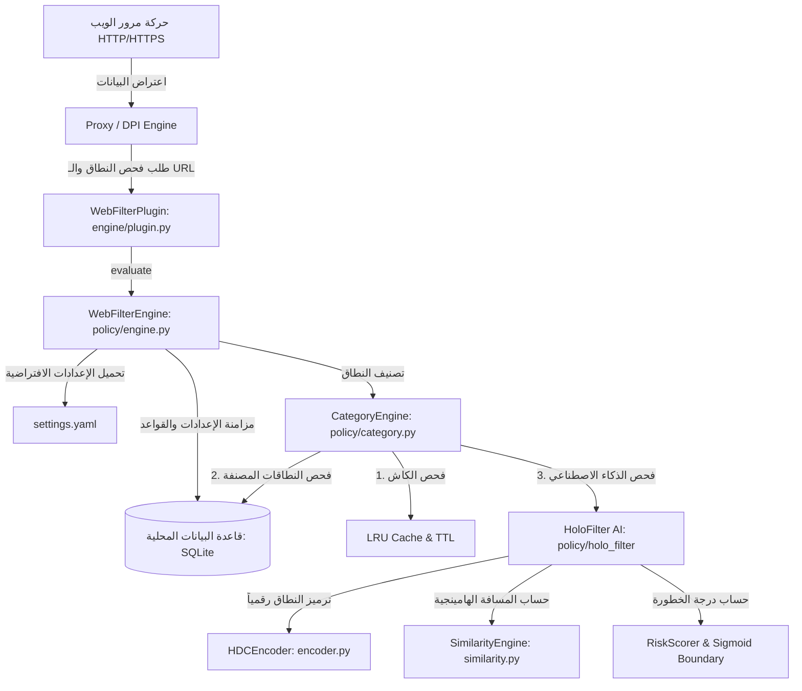

# تقرير المعمارية البرمجية لوحدة تصفية الويب (Web Filter Module)
## نظام جدار حماية الجيل القادم للمؤسسات (bunyanx NGFW)

---

## 1. نظرة عامة والهدف العام (Overview & Purpose)

تمثل وحدة تصفية الويب (`web_filter`) إحدى الركائز التشغيلية والأمنية الأساسية في طبقة التطبيقات (**L7 Application Layer**) لنظام الجدار الناري للمؤسسات. تكمن مهمتها الأساسية في مراقبة حركة مرور الويب (HTTP/HTTPS) وحمايتها عبر:
1. **تطبيق سياسة الاستخدام المقبول (Acceptable Use Policy - AUP):** السماح أو حظر أو مراقبة النطاقات بناءً على تصنيفات محددة (مثل شبكات التواصل الاجتماعي، مواقع المقامرة، إلخ).
2. **الحماية الاستباقية من التهديدات السيبرانية:** حجب نطاقات البرمجيات الخبيثة (Malware)، التصيد الاحتيالي (Phishing)، البوتنت، ونطاقات التحكم والسيطرة (C2).
3. **كشف الهجمات الصفرية (Zero-Day Attacks):** التعرف على النطاقات المولدة عشوائياً (DGA) والروابط المخادعة دون الحاجة للاتصال بالإنترنت، بالاعتماد على خوارزمية ذكاء اصطناعي مبتكرة تعمل محلياً.

---

## 2. معمارية النظام ثلاثية الطبقات (Three-Tier Architecture)

تعمل الوحدة بناءً على بنية برمجية متماسكة وموزعة على ثلاث طبقات تتكامل بشكل سلس مع بقية أجزاء الجدار الناري:



### أ. طبقة الاعتراض وتكامل خط الفحص (Inspection & Interception Layer)
* يتمثل المكون الأساسي هنا في [plugin.py](file:///F:/enterprise_ngfw/modules/web_filter/engine/plugin.py) والذي يرث من `InspectorPlugin`.
* يعترض هذا المكون اتصالات الويب بناءً على المنافذ الشائعة (`80`, `443`, `8080`, `8443`, `3128`) أو بروتوكولات HTTP/HTTPS المحددة بواسطة فاحص الـ SSL.
* يستخرج المكون النطاق أو الروابط (URL) ويمررها لمحرك الفحص الرئيسي، ويتلقى القرار الأمني لتطبيقه (حظر BLOCK، سماح ALLOW، أو مراقبة MONITOR).

### ب. طبقة محرك السياسات والتصنيف (Policy & Categorization Layer)
* يقود هذه الطبقة [engine.py](file:///F:/enterprise_ngfw/modules/web_filter/policy/engine.py) (المصمم بنمط Singleton) ومساعده [category.py](file:///F:/enterprise_ngfw/modules/web_filter/policy/category.py).
* هذه الطبقة مسؤولة عن مزامنة التكوينات وقواعد التصفية دورياً بين ملف الإعدادات `settings.yaml` وقاعدة البيانات المحلية، والتحقق من القواعد الديناميكية (مثل امتدادات الملفات المحظورة أو روابط البحث الآمن).

### ج. طبقة الذكاء الاصطناعي فائق الأبعاد (HoloFilter AI Layer)
* تقع في مجلد [holo_filter](file:///F:/enterprise_ngfw/modules/web_filter/policy/holo_filter/).
* تستخدم تقنية **الحوسبة فائقة الأبعاد (Hyperdimensional Computing - HDC)** لتحويل السلاسل النصية للنطاقات إلى متجهات تمثيلية ضخمة (10,048 بُعداً) ومقارنتها بنماذج رياضية مسبقة التدريب محلياً لكشف السلوكيات المشبوهة للنطاقات بدون أي استعلام خارجي.

---

## 3. آلية الفحص والمطابقة ذات الخمس مستويات (5-Stage Inspection Pipeline)

عندما يستقبل محرك التصفية `CategoryEngine` طلباً لفحص نطاق معين، فإنه يمرر الطلب عبر **5 مستويات تصفية متتالية** لضمان أقصى سرعة وأعلى دقة:

| المستوى | اسم الآلية | الوصف البرمجي والرياضي | زمن الاستجابة المتوقع |
| :--- | :--- | :--- | :--- |
| **المستوى 1** | **الذاكرة المخبئية (LRU+TTL Cache)** | فحص ذاكرة مخبئية سريعة في الذاكرة العشوائية (`_LRUCache`). تعتمد خوارزمية الإخلاء على الأقل استخداماً مؤخراً (LRU) مع وقت انتهاء صلاحية (TTL) محدد بـ 300 ثانية لتحديث السياسات ديناميكياً. | **أقل من 1 ميكروثانية** |
| **المستوى 2** | **التطابق التام (Exact Match)** | فحص جدول النطاقات المخصصة في قاعدة البيانات للمطابقة الحرفية الصريحة (مثل حظر نطاق محدد `evil.com`). | **O(1) عبر جدول الهاش** |
| **المستوى 3** | **مطابقة نطاق الأب (Suffix Match)** | فحص النطاقات الفرعية تدريجياً صعوداً لنطاق الأب. على سبيل المثال: عند فحص `ads.tracker.evil.com` يتم فحص `tracker.evil.com` ثم `evil.com`. | **سريع جداً (تقسيم السلسلة)** |
| **المستوى 4** | **مطابقة النطاقات العامة (Wildcard/Glob Match)** | مطابقة النطاق مع الأنماط التي تحتوي على رموز عامة (مثل `*.evil.com` أو `badsite*`) باستخدام مكتبة `fnmatch` القياسية. | **تناسبي مع حجم قائمة wildcard** |
| **المستوى 5** | **فحص الذكاء الاصطناعي (HoloFilter HDC)** | في حال فشل المستويات الأربعة السابقة وكان النطاق غير مصنف (`UNRATED`)، يتم تشفير النطاق كمتجه فائق الأبعاد ومقارنته بنموذج المتجهات التدريبية لتحديد مستوى الخطورة. | **أقل من 5 مللي ثانية (محلياً)** |

---

## 4. التشريح الداخلي لمحرك الذكاء الاصطناعي (HoloFilter HDC Core)

يمثل **HoloFilter v2** النواة الابتكارية للوحدة. بدلاً من تشغيل شبكات عصبية عميقة (Deep Learning) تستهلك الذاكرة والمعالج وتسبب بطئاً في حركة الحزم، يعتمد هذا المحرك على تمثيلات متجهة فائقة الأبعاد وعمليات جبرية مبسطة:

### 1. المشفر فائق الأبعاد (HDCEncoder)
يقوم المشفر في [encoder.py](file:///F:/enterprise_ngfw/modules/web_filter/policy/holo_filter/encoder.py) بتحويل اسم النطاق (مثل `paypal-security.com`) إلى متجه ثنائي ضخم مكون من 10,048 بت (مخزن في مصفوفة NumPy من نوع `uint64` لتحسين الأداء) عبر ثلاث تقنيات مدمجة:
* **Character Class Embeddings:** ربط الحروف بأصنافها الهيكلية (أحرف، أرقام، رموز خاصة) لمنع الهجمات المعتمدة على خلط الحروف المتشابهة (Homoglyph/Typosquatting).
* **Position-Aware Permutation (\(\rho\)):** تدوير البتات (Bit cyclic shift) بشكل جيب بياني معتمد على موضع الحرف لضمان الاحتفاظ بترتيب السلسلة النصية.
* **Scalar Length Embedding:** تشفير طول السلسلة النصية الفعلي للنطاق ودمجه في المتجه النهائي.
* **N-gram Binding:** دمج كل 3 حروف متتالية (Tri-grams) بعملية XOR المنطقية لتكوين البصمة الهيكلية للنطاق، ثم جمعها بعملية التصويت للأغلبية (Majority Vote Bundling) لتكوين المتجه النهائي للنطاق.

### 2. محرك قياس التشابه (SimilarityEngine)
يقوم المحرك في [similarity.py](file:///F:/enterprise_ngfw/modules/web_filter/policy/holo_filter/similarity.py) بقياس المسافة الهامينجية (Hamming Distance) بين المتجه المولد للنطاق المستعلم ومتجهات النماذج المخزنة (Prototypes) التي تمثل العائلات الثلاث:
* عائلة النطاقات السليمة (Benign)
* عائلة مواقع التصيد الاحتيالي (Phishing)
* عائلات النطاقات المولدة برمجياً (DGA) الموزعة على فروع متعددة (مثل Mirai, Conficker, إلخ).
* يتم حساب التشابه بالمعادلة التالية:
  $$\text{Similarity} = 1.0 - \frac{\text{Hamming Distance}}{\text{Dimensions}}$$

> [!NOTE]
> يتميز الكود البرمجي بالقدرة على استغلال تسريع معالجات إنتل المتطورة **AVX-512** محلياً عبر لغة C++ في الملف [holofilter_simd.cpp](file:///F:/enterprise_ngfw/modules/web_filter/evaluation/holofilter_simd.cpp) باستخدام الدالتين الموجهتين `_mm512_xor_si512` و `_mm512_popcnt_epi64` مما يرفع الإنتاجية التشغيلية إلى أكثر من **1.4 مليون فحص في الثانية (QPS)** للنواة الواحدة.

### 3. مقيّم الخطورة (RiskScorer)
يطبق المكون [risk_scorer.py](file:///F:/enterprise_ngfw/modules/web_filter/policy/holo_filter/risk_scorer.py) معادلة رياضية غير خطية تعتمد على دالة الميزان (Sigmoid Function) لحساب درجة الخطورة الإجمالية (\(R\)):
  $$R = \sigma(w_{\text{dga}} \cdot S_{\text{dga}} + w_{\text{phish}} \cdot S_{\text{phish}} - w_{\text{benign}} \cdot S_{\text{benign}} + b)$$
حيث أن:
* \(S\): هي درجات التشابه مع النماذج الثلاثة.
* \(w\): هي الأوزان المحددة في الإعدادات (مثلاً: وزن الـ DGA هو `12.0` والـ Phish هو `8.0` والـ Benign هو `15.0`).
* \(b\): هو الانحياز للنموذج (Bias) ويساوي `-3.5`.
إذا تجاوزت النتيجة حد الخطورة المعتمد (`0.70` أو 70%)، يتم إصدار قرار الحظر فوراً وتصنيف النطاق ديناميكياً تحت فئة `AI_BLOCK`.

### 4. التدريب الموضعي للنموذج (Hebbian-style Trainer)
يتيح الملف [trainer.py](file:///F:/enterprise_ngfw/modules/web_filter/evaluation/trainer.py) للمشرفين إمكانية إعادة تدريب نموذج الذكاء الاصطناعي محلياً وبضغطة زر واحدة.
* يقرأ البيانات من ملفات CSV المدمجة (Tranco Top-1M للمواقع السليمة، وقاعدة بيانات PhishTank للتصيد، و DGA Archive للنطاقات العشوائية).
* يستخدم تحديث هيب التكراري (Hebbian Learning Rule) لتعديل البتات في المتجهات المرجعية وتقريبها من خصائص العينات الجديدة دون الحاجة لمعالجات رسومية معقدة.
* يحفظ النموذج المحدث في ملف المضغوط `offline_hv.npz` الذي يتم تحميله ديناميكياً بواسطة محرك التصفية عند رصد أي تحديث في زمن تعديل الملف (mtime) وبشكل فوري دون انقطاع الخدمة.

---

## 5. الميزات والخيارات الأمنية والتشغيلية

### أ. ميزة البحث الآمن الإجباري (SafeSearch Enforcement)
يقدم الملف [safe_search.py](file:///F:/enterprise_ngfw/modules/web_filter/policy/safe_search.py) آليتين لفرض البحث الآمن على محركات البحث (مثل Google, Bing, DuckDuckGo):
1. **تعديل الروابط (URL Rewrite):** تتبع مسار طلب HTTP وإرفاق المعامل `safe=active` برمجياً بالرابط قبل تمريره للمتصفح.
2. **توجيه الـ DNS:** إعادة توجيه استعلامات DNS لمحركات البحث إلى العناوين الآمنة المعتمدة (CNAMEs) مثل تحويل `google.com` إلى `forcesafesearch.google.com`.

### ب. تصميم الفتح عند الفشل (Fail-Open Design)
وفقاً لأفضل الممارسات الأمنية المطبقة في المؤسسات الكبيرة، صُممت الوحدة للعمل بوضع **Fail-Open**:
* في حال حدوث أي استثناء برمجى غير متوقع، أو تعطل كامل لقاعدة البيانات المحلية، يتم تمرير حركة مرور الويب للمستخدم بشكل طبيعي دون إعاقة عمل المؤسسة، مع تسجيل المشكلة في سجل الأخطاء.

### ج. التحكم والمزامنة التلقائية بدون إعادة تشغيل
* يقوم محرك التصفية بمراقبة التغييرات كل 5 ثوانٍ، ومزامنة أي قواعد مخصصة أو تعديل في السياسات يجريه المشرف عبر واجهة الويب وحفظه في جداول قاعدة البيانات.
* يتم مسح ذاكرة الكاش بالكامل وتحديث المعاملات بمجرد تعديل الإعدادات لضمان الفاعلية الفورية للسياسات الأمنية الجديدة.

---

## 6. الهيكل التنظيمي للملفات والمسؤوليات (File Structure Details)

تحتوي الوحدة على الملفات والمجلدات التالية مع توضيح عمل كل منها:

```text
modules/web_filter/
├── __init__.py                # مدخل تعريف الحزمة البرمجية للوحدة
├── manifest.yaml              # بيان تعريف الوحدة، إصدارها (2.0.0) ومتطلباتها وأولوياتها
├── module.py                  # كلاس التهيئة الأساسي للوحدة وتسجيل المحرك في نظام NGFW المركزي
├── models.py                  # نماذج جداول SQLAlchemy لقاعدة البيانات (WebFilterConfig, WebFilterCategory, WebFilterDomain)
│
├── config/
│   ├── loader.py              # كلاس التهيئة الفردي (Singleton Loader) لقراءة ملف settings.yaml
│   └── settings.yaml          # الإعدادات الافتراضية، الأوزان، وقواعد الاستثناء الأولية للمواقع
│
├── engine/
│   └── plugin.py              # المكون الوسيط لخط الفحص (Pipeline Plugin) لاستقبال وفحص الطلبات وتطبيق الحظر
│
├── policy/
│   ├── engine.py              # المحرك الاستراتيجي لتقييم السياسات والتكامل مع محركات البحث والملفات المحظورة
│   ├── category.py            # محرك المزامنة ومطابقة النطاقات وإدارة الذاكرة المخبئية LRU
│   ├── safe_search.py         # المسؤول عن تعديل روابط محركات البحث وفرض CNAMEs الآمنة
│   └── holo_filter/           # مجلد مكتبة الحوسبة فائقة الأبعاد (AI Engine)
│       ├── __init__.py        # الواجهة الخارجية (Facade) لتشغيل وفحص النطاقات بالذكاء الاصطناعي
│       ├── encoder.py         # مشفر النطاقات لمتجهات فائقة الأبعاد
│       ├── similarity.py      # محرك قياس التشابه الهامينجي الفائق السرعة
│       ├── risk_scorer.py     # مقيّم المخاطر وحساب دالة Sigmoid وتحديد قرارات BLOCK/ALLOW
│       └── vector_store.py    # مخزن النماذج المرجعية وإدارتها وحفظها على القرص
│
├── api/
│   └── router.py              # مسارات FastAPI للوحة التحكم لإدارة الإعدادات وقواعد التصفية وبدء التدريب
│
└── evaluation/
    ├── trainer.py             # خوارزمية تدريب النموذج الذكي محلياً وتوليد ملف offline_hv.npz
    ├── test_ai.py             # سكربت فحص محلي واختبار دقة محرك الذكاء الاصطناعي
    ├── test_integration.py    # اختبار دقة وتكامل محرك الفحص وقاعدة البيانات
    ├── benchmark.py           # سكربت لقياس سرعة المعالجة والإنتاجية البرمجية
    ├── holofilter_simd.cpp    # محاكي تسريع الأداء بلغة C++ باستخدام تعليمات AVX-512 للـ CPU
    └── simulate_network_integration.py # محاكي لحركة مرور الشبكة والتحقق من المخرجات الفعلية للـ Proxy
```

---

## 7. واجهات التحكم البرمجية (REST API Interfaces)

تفتح الوحدة مجموعة من نهايات الخدمة (Endpoints) عبر إطار عمل FastAPI لتسهيل إدارتها من واجهة الويب التفاعلية:

1. **حالة المحرك الحالي (`GET /api/v1/web_filter/status`):**
   * يعيد معلومات حية عن حالة التفعيل، وعدد النطاقات والمجموعات المضافة، وتفاصيل صحة نموذج الذكاء الاصطناعي ووقت آخر تدريب له.
2. **إدارة الإعدادات (`GET & PUT /api/v1/web_filter/config`):**
   * جلب وتعديل التكوين العام (مثل نمط التشغيل Enforce/Monitor، تفعيل SafeSearch، وتعديل أوزان نموذج HDC).
3. **إدارة التصنيفات (`GET, POST, PUT, DELETE /api/v1/web_filter/categories`):**
   * إدارة فئات التصفية مع منع حذف الفئات الأساسية المدمجة بالنظام لضمان الاستقرار.
4. **إدارة النطاقات المخصصة (`GET, POST, PUT, DELETE /api/v1/web_filter/domains`):**
   * إضافة نطاقات للترشيح المخصص مع تفعيل التحقق التلقائي من المدخلات باستخدام تعابير نمطية (Regex) لمنع هجمات حقن الرموز الضارة.
5. **بدء تدريب النموذج (`POST /api/v1/web_filter/train`):**
   * إطلاق مهمة تدريب في الخلفية (Background Task) لتقييم البيانات التدريبية وبناء النماذج المرجعية وتحديث ملف المتجهات.
