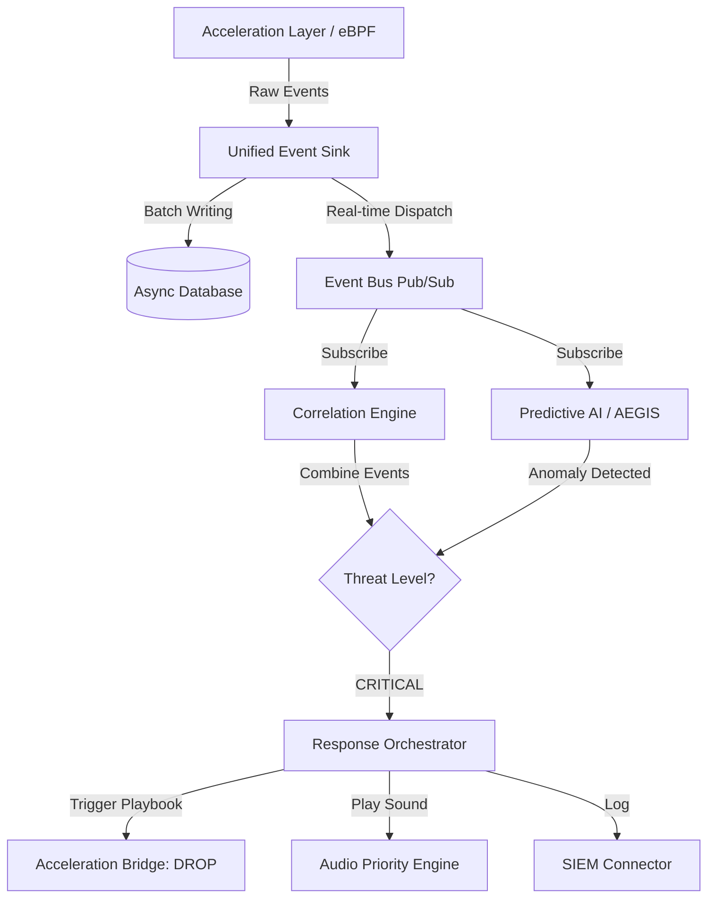

# توثيق تقني متقدم: طبقة النظام (System Control Plane)

**الجزء من مشروع: Enterprise bunyanx NGFW**

---

## 1. المقدمة (Introduction)

تُمثل طبقة النظام (`F:\enterprise_ngfw\system`) العقل المدبر والجهاز العصبي المركزي لمشروع (Enterprise NGFW). ففي حين تتولى طبقة التسريع (`acceleration`) التصفية الأولية السريعة للحزم، وتقوم طبقة الوحدات (`modules`) بمهام الفحص المتخصصة، تتكفل طبقة النظام بإدارة كل هذه المكونات، تنسيق العمليات، وإجراء التحليل المعمق للتهديدات.

**الهدف الأساسي:** توفير بيئة معمارية مرنة، غير مركزية (Decoupled)، ومبنية على الأحداث (Event-Driven)، قادرة على ربط الفحص العميق (DPI) وأنظمة الذكاء الاصطناعي (AEGIS v3) مع آليات الاستجابة الآلية (Incident Response) والتوجيه الشبكي المتقدم، لتكوين استجابة أمنية موحدة ومتماسكة ضد التهديدات المتقدمة (APTs).

---

## 2. المكونات المعمارية الحديثة (Modern Architecture Components)

خلافاً للإصدارات القديمة التي اقتصرت على السياسات، يحتوي النظام الحالي على عشرات المكونات الفرعية المتقدمة:

### أ. العصب المركزي (Core System)

- **محرك ارتباط الأحداث (Correlation Engine):** تجميع الأحداث المنفصلة (مثل: مسح المنافذ مع تقييم سلبي للذكاء الاصطناعي) لتكوين استنتاج أمني عالي الخطورة.
- **قاطع الدائرة (Circuit Breaker):** هيكل بيانات يراقب معدلات الفشل (Error Rates) لكل وحدة لحماية النظام من الانهيار المتسلسل (Cascading Failures).
- **ناقل الأحداث (Event Bus):** العمود الفقري الذي ينقل كائنات من نوع `EventSchema` بين المكونات بشكل غير متزامن (Asynchronous) عبر نمط Pub/Sub.
- **جسر التسريع (Acceleration Bridge):** أداة التواصل العكسي مع النواة/eBPF لحقن سياسات الحظر الفورية.

### ب. الذكاء الاصطناعي والاستخبارات (AI & Threat Intel)

- **النواة الذكية (`ml_core`):** تضم محرك `Predictive AI` (AEGIS) القائم على تحليل السلوك واستخدام الشبكات العصبية للتنبؤ بالهجمات الصامتة.
- **استخبارات التهديدات (`threat_intel`):** جلب ومعالجة مؤشرات الاختراق (IOCs) والخلاصات العالمية (Feeds)، مع تحليل الموقع الجغرافي (GeoIP).

### ج. الاستجابة والتعافي (Response & Recovery)

- **منسق الاستجابة (`response/orchestrator.py`):** تشغيل خطط استجابة آلية (Playbooks) لردع الهجمات بمجرد كشفها، مثل عزل المضيف المخترق أو تغيير مسار الشبكة.
- **نظام التنبيه الصوتي المؤسسي (`audio/`):** نظام توجيه التنبيهات والأصوات بناءً على مصفوفة الأولويات (Priority Engine) لإصدار إنذارات حرجة داخل مركز عمليات الأمان (SOC) عند الهجمات الطارئة (Night/Silent Profiles).

### د. تكامل البنية التحتية (Infrastructure Integration)

- **الشبكات والتوجيه (`networking/`):** إعداد الواجهات (Interface Manager)، وكلاء المرور الشفاف (Transparent Proxy)، وربط معالجات المعالج (Core Affinity) لضمان أعلى أداء، بالإضافة لأدوات التحضير (Out-of-box setup).
- **قواعد البيانات (`database/`):** تخزين وإدارة البيانات باستخدام عمليات هجرة غير متزامنة (Async Alembic Migrations).
- **إدارة المفاتيح (`pki/`):** إدارة بروتوكول المصادقة الثنائية (mTLS Manager) لضمان اتصال مشفر بين وحدات الـ NGFW المتعددة وأدوات فحص SSL.
- **ربط SIEM (`siem/`):** موصلات مباشرة (Connectors) لتصدير السجلات والمعلومات الأمنية إلى أنظمة إدارة المعلومات والأحداث الأمنية (SIEM).

---

## 3. آلية العمل وتدفق البيانات (Workflow)

---

## 4. الإعدادات والتكوين (Configuration)

تدار كفاءة النظام عبر مجموعة من المحددات الحساسة الموزعة:

- **حدود الارتباط (Correlation Thresholds):** حظر تلقائي إذا صدرت 3 تهديدات من نفس الـ IP خلال 60 ثانية، أو مسح لـ 5 منافذ في 30 ثانية.
- **سياسة الفشل (Fail-Closed vs Fail-Open):** إمكانية إيقاف تمرير الترافيك في حال تعطل أحد المحركات الأمنية، أو السماح به لتغليب التوافرية.
- **التوجيه التكيفي (Adaptive Steering):** باستخدام أدوات الـ `networking` و `core_affinity`، يتم توجيه حزم البيانات لنواة المعالج الأقل استهلاكاً لمنع الاختناقات (Bottlenecks).

---

## 5. التحليل الأمني (Threat Model)

| التهديد (Threat) | آلية الحماية داخل طبقة النظام (Mitigation Mechanism) |
| :--- | :--- |
| **استنزاف الذاكرة (Log Flooding / DoS)** | حماية ضد تدفق البيانات المفرط عبر إسقاط التليمتري الزائد تلقائياً. |
| **الانهيار المتسلسل (Cascading Failures)** | استخدام `Circuit Breaker` لعزل أي وحدة تستهلك الموارد أو تتأخر في الاستجابة، وتفعيل الـ Fallback. |
| **التهرب عبر الهجمات البطيئة (Slow/Low APTs)** | نافذة انزلاقية (Sliding Window) تجمع النقاط عبر `ml_core` و `correlation` لكشف المخترقين الصامتين. |
| **الاعتمادية العمياء (Single Point of Failure)** | الفصل المعماري التام باستخدام `EventBus`؛ إذا انهار محرك تصفية الويب، سيستمر محرك الذكاء الاصطناعي في العمل كالمعتاد. |

---

## 6. الخلاصة (Conclusion)

تعتبر طبقة `system` مثالاً هندسياً رائداً في بناء منصات الأمن المؤسسي (Mission-Critical Cybersecurity Platforms). ابتعادها عن التصميم المتجانس (Monolithic) لصالح التصميم التفاعلي المبني على الأحداث أعطاها مرونة هائلة. بفضل آليات الاستجابة الآلية (Response Orchestrator)، التنبيه الصوتي (Audio Priority)، ونواة الشبكات المتقدمة (Networking Affinity)، تحول النظام من مجرد "أداة فلترة" إلى نظام بيئي متكامل للاكتشاف والردع.
